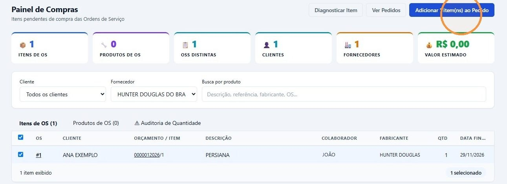
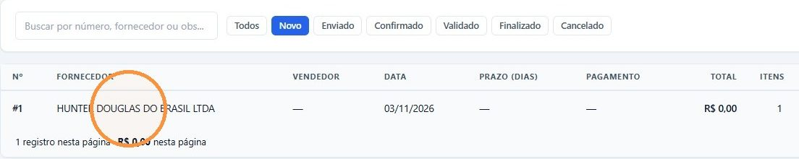

## Antes de começar

- Permissões necessárias: **Painel de Compras › Visualizar** e **Pedidos de Compra › Criar** e **Editar**.
- Confira no painel o fornecedor e o cliente de cada item antes de marcar. Veja [Ver o que precisa ser comprado](/decor/compras/ver-o-que-comprar/).

## Passo a passo

1. Em **Compras › Painel de Compras**, escolha o fornecedor em **Fornecedor**.
2. Marque a caixa dos itens que vai pedir. Para marcar todos os da lista, use a caixa do cabeçalho.
3. Clique em **Adicionar N item(ns) ao Pedido**.

   

4. A janela **Confirmar Adição ao Pedido** mostra, para cada fornecedor, quantos itens entram e em qual pedido:
   - **→ Novo pedido será criado**: o fornecedor não tem pedido em aberto;
   - **→ Pedido #… (existente)**: os itens entram no pedido **Novo** que esse fornecedor já tem.

   Clique em **Confirmar**.

   

5. Os itens saem do painel, e o pedido aparece em **Compras › Pedidos de Compra**, com o status **Novo**.

   

## Resultado esperado

- Cada fornecedor tem o seu pedido. Se você marcar itens de dois fornecedores, saem dois pedidos.
- Enquanto o pedido de um fornecedor está **Novo**, os itens que você acrescenta depois, de qualquer cliente, entram nele. Depois que o pedido é enviado, os novos itens vão para outro pedido.
- A quantidade pedida é a da ordem de serviço. O valor unitário é o preço de fábrica do orçamento, já com o desconto do fabricante, quando houver.

## Completar o pedido

No pedido, clique em **Editar** para preencher **Vendedor do Fornecedor**, **Prazo Entrega (dias)**, **Condição Pagamento**, **Forma Pagamento** e **Observações Importantes**. Esses dados vão no pedido enviado ao fornecedor.

O próximo passo é [enviar o pedido ao fornecedor](/decor/compras/enviar-e-confirmar-pedido/).

## Se algo der errado

| Mensagem | O que fazer |
|---|---|
| "Compra bloqueada — item já comprado" | Outra pessoa pediu o item depois que o painel foi aberto. O sistema tira o item da seleção e atualiza a lista. Confira e confirme os demais. |
| "Selecione ao menos um item" | Marque a caixa de pelo menos um item. |
