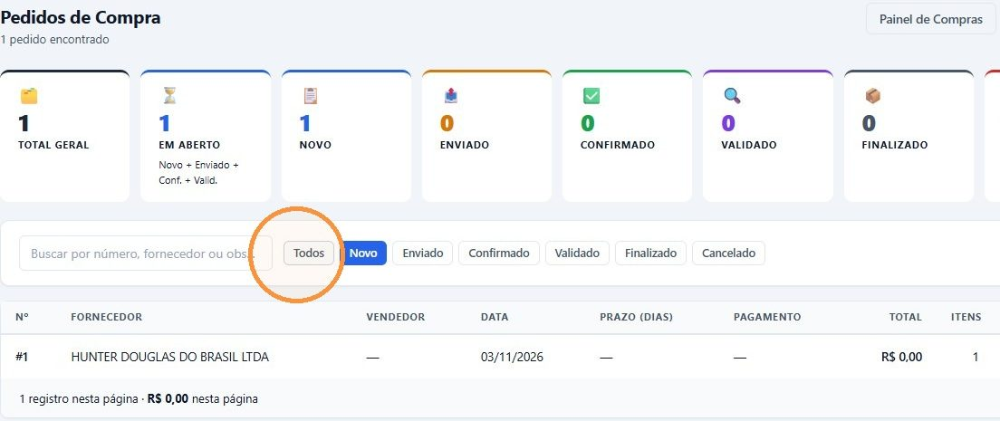
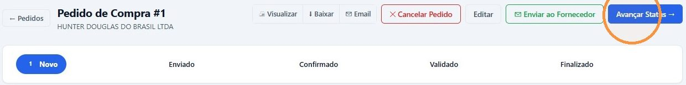
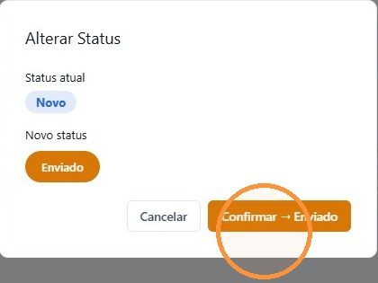
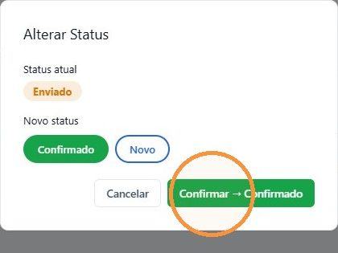

## Antes de começar

- Permissão necessária: **Pedidos de Compra › Editar**. Para cancelar, **Pedidos de Compra › Cancelar**.
- Confira os itens e o cabeçalho do pedido (prazo, condição e forma de pagamento). Veja [Criar o pedido de compra](/decor/compras/criar-pedido-de-compra/).

## Os status do pedido

| Status | Quer dizer |
|---|---|
| **Novo** | O pedido foi criado e ainda não foi mandado ao fornecedor. |
| **Enviado** | O pedido foi mandado ao fornecedor. |
| **Confirmado** | O fornecedor devolveu o espelho do pedido, e a loja conferiu que está tudo certo. |
| **Validado** | O material chegou. O status muda sozinho quando a chegada de todos os itens é registrada. |
| **Finalizado** | O processo terminou. Depois disso, o pedido não pode mais ser editado. |
| **Cancelado** | O pedido foi cancelado, e os itens voltaram ao Painel de Compras. |

## Abrir o pedido

1. Em **Compras › Pedidos de Compra**, clique em **Todos**, ou no status que quer ver, e no número do pedido.

   

## Enviar por e-mail

1. No pedido **Novo**, clique em **✉ Enviar ao Fornecedor**.
2. Confira o **E-mail do Fornecedor**. Em branco, vale o e-mail do cadastro do fornecedor. Se quiser, informe o **E-mail da Transportadora**.
3. Clique em **✉ Enviar E-mail**.

O fornecedor recebe o pedido com um link para responder. O status passa sozinho para **Enviado**.

## Registrar o pedido feito no site do fornecedor

Quando o fornecedor tem site próprio para pedidos (por exemplo, a Hunter Douglas), faça o pedido no site dele e registre o envio no sistema:

1. No pedido aberto, clique em **Avançar Status →**.

   

2. Na janela **Alterar Status**, clique em **Confirmar → Enviado**.

   

## Registrar a confirmação do fornecedor

1. Confira o espelho do pedido que o fornecedor devolveu: itens, quantidades, medidas e valores.
2. Se estiver tudo certo, clique em **Avançar Status →** e em **Confirmar → Confirmado**.

   

Se o espelho precisar de correção, a mesma janela permite voltar o pedido para **Novo**. Corrija e envie de novo.

### Acompanhar a resposta pelo link

Quando o pedido é enviado por e-mail, a aba **Rastreio** do pedido mostra cada etapa da resposta do fornecedor: **Enviado**, **Recebido**, **Disponibilidade**, **Aprovado**, **Despachado** e **Entregue**. Mostra também a confirmação item a item, a nota fiscal, o código de rastreio e a previsão de entrega que ele informar.

Com a disponibilidade confirmada pelo fornecedor, aparece o botão **✓ Aprovar**. Aprovar registra o aceite da loja no rastreio, mas **não** muda o status do pedido. Para isso, avance para **Confirmado**.

## Depois da confirmação

- **Validado:** muda sozinho quando a chegada de todos os itens é registrada. Veja [Registrar a chegada da nota de compra](/decor/compras/registrar-chegada/).
- **Finalizado:** avance à mão, em **Avançar Status →**, quando o processo estiver encerrado.

## Cancelar o pedido

O botão **✕ Cancelar Pedido** aparece com o pedido em **Novo** ou **Enviado**.

1. Clique em **✕ Cancelar Pedido** e em **Solicitar Cancelamento**.
2. Se houver regra de autorização, o autorizador recebe um token de 6 dígitos pelo WhatsApp. Digite o token e clique em **Confirmar com Token**. Sem regra configurada, o cancelamento é feito na hora.

O pedido passa para **Cancelado**, e os itens voltam ao Painel de Compras, prontos para um novo pedido.

## Se algo der errado

| Mensagem ou sintoma | O que fazer |
|---|---|
| "E-mail do fornecedor não encontrado. Informe o e-mail manualmente." | Digite o e-mail na janela ou corrija o cadastro do fornecedor. |
| "Configuração SMTP não definida para esta empresa" | O envio de e-mail da empresa não está configurado. Fale com o administrador. |
| "Falha ao enviar e-mail ao fornecedor" | O e-mail não saiu e o status não mudou. Confira o endereço e tente de novo. |
| O botão **Enviar ao Fornecedor** não aparece | Ele só aparece com o pedido em **Novo**. |
| O botão **Cancelar Pedido** não aparece | O pedido já passou de **Enviado**, ou falta a permissão **Pedidos de Compra › Cancelar**. |
| "Não é possível cancelar: o pedido possui chegadas de itens registradas" | Já há chegada registrada no pedido. Ele não pode mais ser cancelado. |
