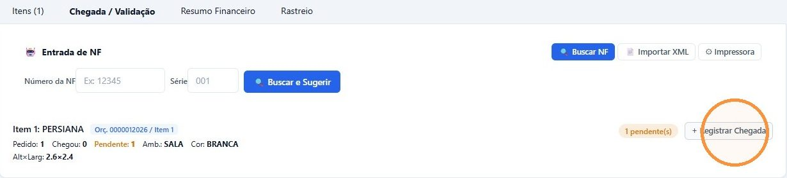
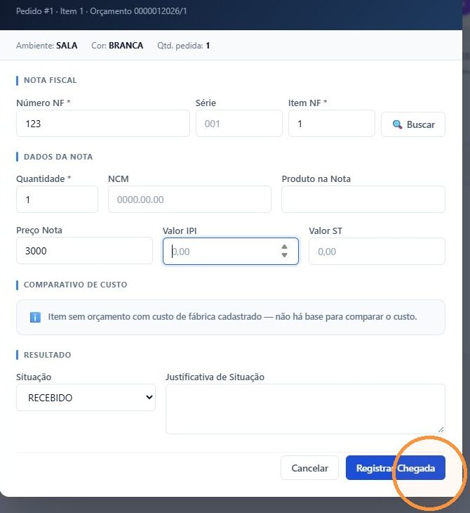
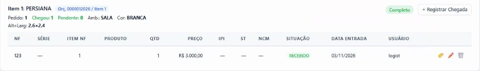

## Antes de começar

- Permissão necessária: **Pedidos de Compra › Editar**.
- Tenha em mãos a nota fiscal do fornecedor: número, série e o número de cada item na nota.

## Passo a passo

1. Em **Compras › Pedidos de Compra**, clique em **Todos** e no pedido.
2. Abra a aba **Chegada / Validação**. Cada item mostra **Pedido**, **Chegou** e **Pendente**.
3. No item, clique em **+ Registrar Chegada**.

   

4. A janela já traz, no topo, o pedido, o item e o orçamento. Preencha:
   - em **Nota Fiscal**: **Número NF**, **Série** e **Item NF**, que é o número do item na nota, e não a quantidade;
   - em **Dados da Nota**: **Quantidade**, **NCM**, **Produto na Nota** e **Preço Nota**;
   - se a nota tiver, **Valor IPI** e **Valor ST**.

   Se a nota já estiver no sistema, informe número e série e clique em **Buscar** para preencher os dados.

5. Confira o **Comparativo de Custo** e a **Situação** (veja abaixo).
6. Clique em **Registrar Chegada**.

   

7. Aparece **Chegada registrada!**. Para etiquetar o material, informe as **Cópias** e clique em **🏷️ Imprimir Etiqueta**. Senão, clique em **Fechar**.

## Resultado esperado

- A nota aparece embaixo do item, e o item fica **Completo** quando a quantidade que chegou alcança a do pedido. Se chegou só parte, o item continua com a quantidade **Pendente**.

  

- Quando todos os itens do pedido chegam, o pedido passa sozinho para **Validado**. Não é preciso avançar o status.
- O material passa a aparecer como chegado em **Logística › Painel de Entregas**, no filtro **Só chegados**. Veja [Usar o Painel de Entregas](/decor/logistica/painel-de-entregas/).

Depois da chegada, conclua no fluxo de pós-venda a tarefa de acompanhar o transporte. Veja [Acompanhar a produção e o transporte](/decor/fluxos/acompanhar-producao-e-transporte/).

## Comparativo de custo e situação

O **Comparativo de Custo** compara o custo da nota com o custo de fábrica do orçamento. A diferença pode ser de até 2%, para mais ou para menos.

- Até 2%, a situação fica **RECEBIDO**.
- Acima de 2%, a situação muda sozinha para **INCONSISTENTE**, e a **Justificativa de Situação** passa a ser obrigatória.
- Sem custo de fábrica no orçamento, não há base de comparação, e o quadro avisa.

Você também pode escolher a situação: **RECEBIDO PARCIAL**, **DIVERGÊNCIA** (pede justificativa) ou **DEVOLVIDO**. Depois que você muda a situação à mão, o cálculo automático não a altera mais.

## Lançar a nota inteira de uma vez

No quadro **Entrada de NF**, no alto da aba:

- **🔍 Buscar NF:** informe **Número da NF** e **Série** e clique em **Buscar e Sugerir**. Se a nota já estiver no sistema, aparecem as correspondências entre os itens da nota e os do pedido, para registrar a chegada de todos de uma vez.
- **📄 Importar XML:** envie o XML da nota. Ela é importada e vinculada ao pedido, e em seguida as correspondências são buscadas.

## Corrigir uma chegada

Na linha da nota, embaixo do item, use o lápis para editar ou a lixeira para excluir. Se você excluir uma chegada de um pedido **Validado** e algum item deixar de estar completo, o pedido volta para **Confirmado**.

## Se algo der errado

| Mensagem | O que fazer |
|---|---|
| "NF, item e quantidade são obrigatórios" | Preencha **Número NF**, **Item NF** e **Quantidade**. |
| "Justificativa obrigatória para situação INCONSISTENTE" | Explique a diferença de custo em **Justificativa de Situação**. |
| "Nota não encontrada no sistema. Preencha manualmente." | A nota ainda não foi importada. Digite os dados ou use **Importar XML**. |
