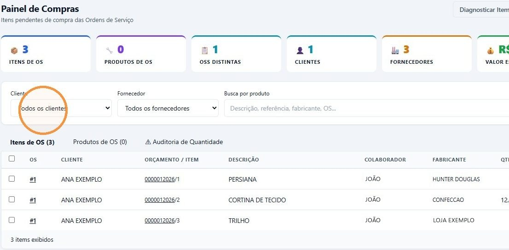
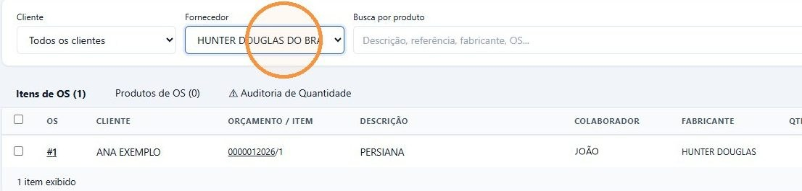
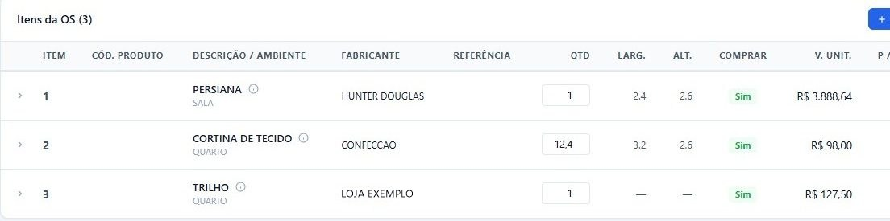

## Antes de começar

- Permissão necessária: **Painel de Compras › Visualizar**.
- O item só chega ao painel depois de liberado para compra na ordem de serviço, com **Comprar?** em **Sim**. Veja [Liberar os itens da OS para compra](/decor/ordens-servico/liberar-compras/).

## Passo a passo

1. No menu, em **Compras**, clique em **Painel de Compras**. A aba **Itens de OS** mostra tudo o que ainda precisa ser pedido, com a OS, o cliente, o orçamento, o vendedor e o fabricante de cada item.

   

2. Para ver só parte da lista, escolha o **Cliente** ou o **Fornecedor**. Em **Busca por produto**, dá para procurar por descrição, referência, fabricante ou número da OS.

   

3. Para pedir os itens, siga [Criar o pedido de compra](/decor/compras/criar-pedido-de-compra/).

Clique no número da OS ou do orçamento para abri-los. Ao voltar, o painel mantém os filtros e a posição da lista.

## O que entra no painel

Um item aparece no painel quando:

- está com **Comprar?** em **Sim** na ordem de serviço;
- ainda não está em nenhum pedido de compra;
- o fabricante do item tem um fornecedor vinculado.

Quando o item entra num pedido, ele sai do painel. Se o pedido for cancelado, o item volta.

Na OS, a coluna **Comprar** mostra **Sim** nos itens já liberados.

## Outras abas e ferramentas

- **Produtos de OS:** os produtos lançados na lista de produtos da própria OS, que não vêm dos itens do orçamento. Eles aparecem quando a OS está **Fechada** e podem ser marcados e pedidos da mesma forma.
- **⚠ Auditoria de Quantidade:** compara a quantidade de cada pedido com a da OS e a do orçamento, e marca em vermelho o que já foi recebido acima da OS. A consulta é pesada e só roda quando você clica em **Atualizar auditoria**.
- **Diagnosticar Item:** informe o número do orçamento e do item para saber por que ele não aparece no painel.

## Se algo der errado

Um item liberado não aparece? Clique em **Diagnosticar Item**. O diagnóstico aponta o motivo:

| O diagnóstico diz | O que fazer |
|---|---|
| Campo "comprar" não está marcado como S | Na OS, edite o item e coloque **Comprar?** em **Sim**. |
| Item já vinculado ao pedido de compra #… | O item já foi pedido. Abra o pedido em **Compras › Pedidos de Compra**. |
| Item da OS não possui fabricante informado | Na OS, edite o item e preencha o **Fabricante**. |
| Fabricante "…" não possui fornecedor vinculado | Peça ao administrador para vincular um fornecedor a esse fabricante. |
| Item não encontrado | Confira o número do orçamento e do item. Se estiverem certos, a OS ainda não foi criada. |

Se o painel mostrar **Nenhum item pendente de compra**, não há nada liberado para pedir.
