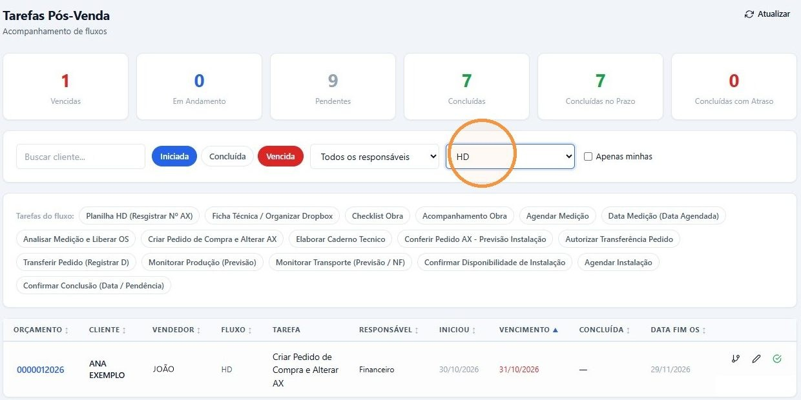
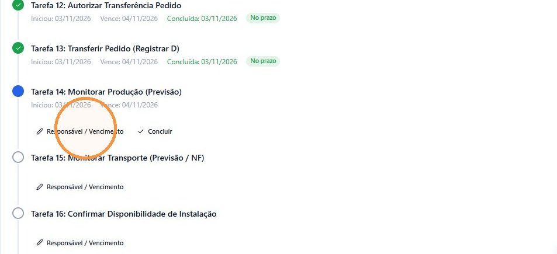
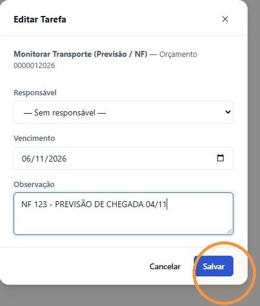
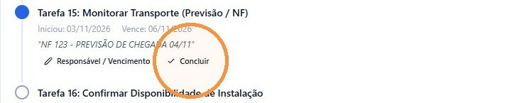
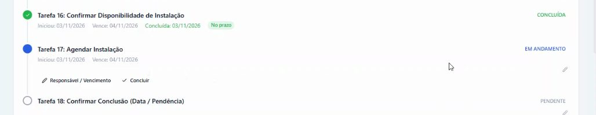

## Antes de começar

- Permissão necessária: **Orçamentos › Editar**. Para mudar o responsável e o vencimento, também **Fluxos P.Venda › Editar**.
- O pedido de compra já foi feito e confirmado pelo fornecedor. Veja [Enviar o pedido ao fornecedor e registrar a confirmação](/decor/compras/enviar-e-confirmar-pedido/).

As tarefas e os nomes abaixo são de um fluxo de exemplo. Os do seu fluxo são definidos em **Administração › Fluxos P.Venda**.

## Encontrar as vendas em produção ou em transporte

1. Em **Comercial › Fluxo de Venda**, escolha o fluxo na lista de fluxos.
2. Em **Tarefas do fluxo**, clique na etapa que quer ver, por exemplo **Monitorar Produção (Previsão)** ou **Monitorar Transporte (Previsão / NF)**.

   

3. Na linha da venda, clique no primeiro ícone, **Ver fluxo no orçamento**, para ver a sequência das tarefas e o que já foi feito.

## Acompanhar a produção

1. Na tarefa **Monitorar Produção (Previsão)**, clique em **Responsável / Vencimento**.

   

2. Na janela **Editar Tarefa**, escolha o **Responsável**, ajuste o **Vencimento** para a previsão do fornecedor e, se quiser, escreva uma **Observação**. Clique em **Salvar**.
3. Quando o fornecedor terminar a produção, clique em **Concluir** e em **Confirmar Conclusão**. A tarefa de transporte começa.

Se faltar algo para produzir, como um suporte, fale com o cliente: avise e combine se ele vai aguardar ou trocar o item.

## Acompanhar o transporte

1. Na tarefa **Monitorar Transporte (Previsão / NF)**, clique em **Responsável / Vencimento**.
2. Em **Observação**, escreva a nota fiscal em que o material vem e a previsão de chegada, por exemplo **NF 123 - PREVISÃO DE CHEGADA 04/11**. Clique em **Salvar**.

   

A observação fica visível embaixo da tarefa, para quem acompanha o fluxo.

## Quando o material chegar

1. Registre a chegada da nota no pedido de compra. Veja [Registrar a chegada da nota de compra](/decor/compras/registrar-chegada/).
2. No fluxo, na tarefa **Monitorar Transporte (Previsão / NF)**, clique em **Concluir** e em **Confirmar Conclusão**.

   

3. Na tarefa **Confirmar Disponibilidade de Instalação**, confira se o que precisa para instalar chegou e conclua.
4. A tarefa **Agendar Instalação** fica **EM ANDAMENTO**. Fale com o cliente ou com o arquiteto e, com o ok dele, crie a entrega. Veja [Criar a entrega e o link do instalador](/decor/logistica/criar-entrega/).

   

## Dicas

- **Só a tarefa da vez tem Concluir.** As seguintes mostram apenas **Responsável / Vencimento**.
- **A nota fiscal e a previsão vão na Observação.** A janela **Editar Tarefa** não tem campo próprio para elas.
- **Ajuste o vencimento da tarefa em andamento.** O vencimento de uma tarefa que ainda não começou é recalculado quando ela começa. Veja [Concluir uma tarefa do fluxo](/decor/fluxos/concluir-tarefa/).
