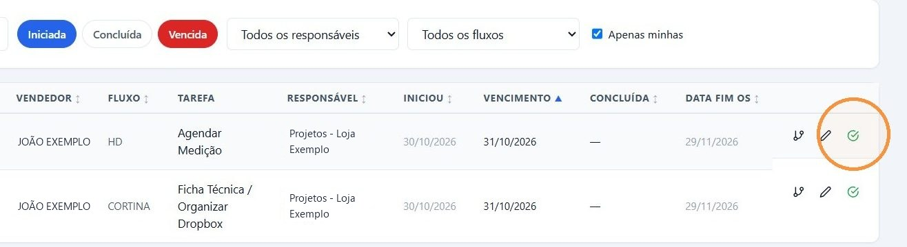
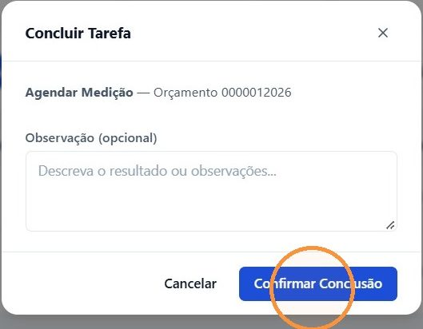
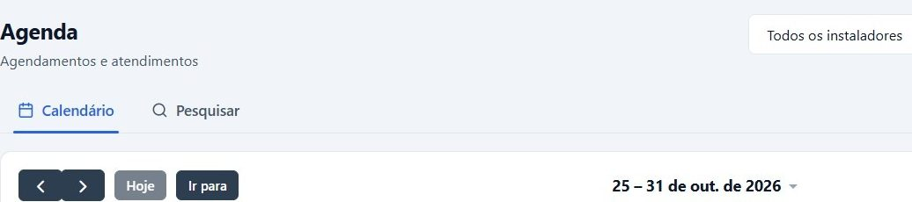
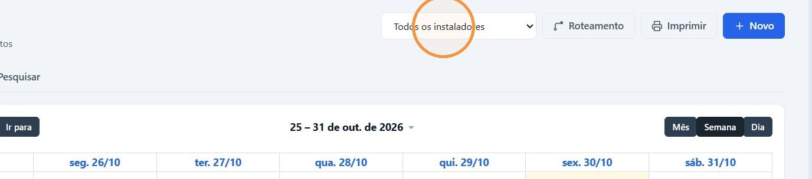
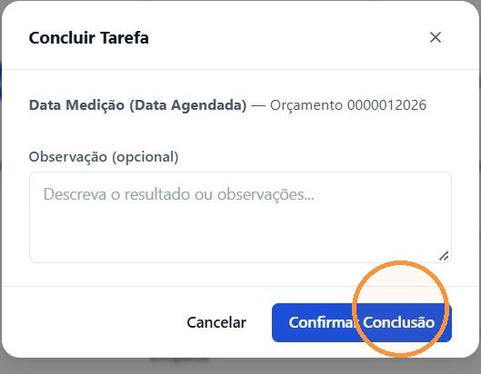
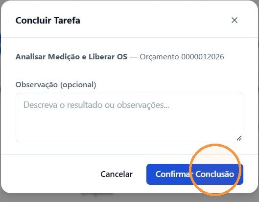
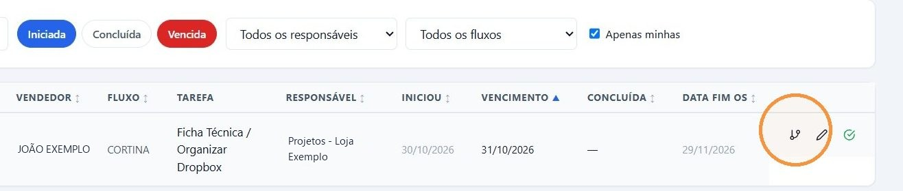
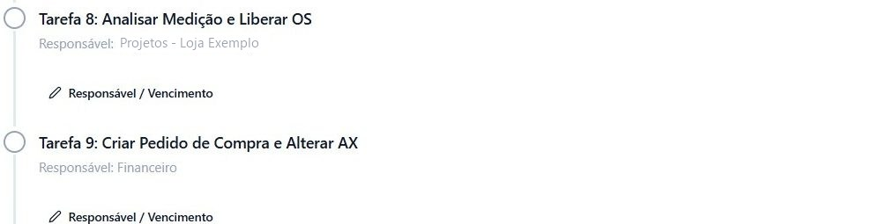

## Antes de começar

- Os nomes das tarefas vêm do modelo de fluxo da loja, em **Administração › Fluxos P.Venda**. Neste artigo, o exemplo usa **Agendar Medição**, **Data Medição (Data Agendada)** e **Analisar Medição e Liberar OS**.
- Para concluir as tarefas, veja [Concluir uma tarefa do fluxo](/decor/fluxos/concluir-tarefa/).

## Agendar a medição

1. Em **Comercial › Fluxo de Venda**, na linha de **Agendar Medição**, clique no ícone verde **Concluir tarefa**.

   

2. Se quiser, registre em **Observação (opcional)** o que foi combinado e clique em **Confirmar Conclusão**.

   

3. Para marcar a visita, acesse **Comercial › Agenda**. A tela abre em **Calendário**, com as visões **Mês**, **Semana** e **Dia**.

   

4. Em **Todos os instaladores**, escolha quem faz a medição para ver a agenda dele, e clique em **+ Novo** para criar o compromisso.

   

## Registrar a medição

1. Depois da visita, na linha de **Data Medição (Data Agendada)**, clique em **Concluir tarefa** e em **Confirmar Conclusão**.

   

2. A linha passa para **Analisar Medição e Liberar OS**. Confira a medida com o orçamento e conclua a tarefa.

   

## Resultado esperado

O fluxo segue para a próxima tarefa, que costuma ter outro responsável. Com **Apenas minhas** marcado, a linha sai da sua lista.

Na tela do fluxo, a tarefa seguinte já aparece com o novo responsável.

O próximo passo é [liberar os itens da OS para compra](/decor/ordens-servico/liberar-compras/).

## Dicas

- **As janelas de conclusão só têm Observação.** A data, o técnico e a medida não têm campo próprio nas tarefas. Use a observação para registrar o que for importante, como a data combinada ou uma diferença de medida.
