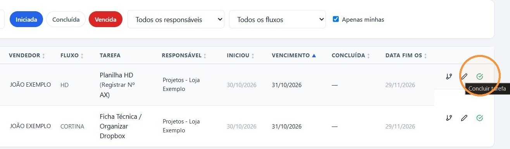
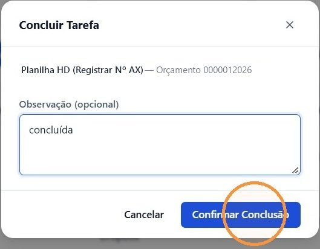
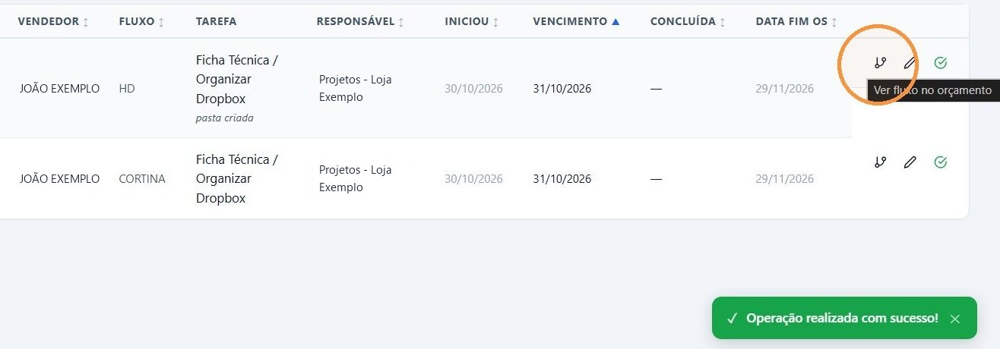
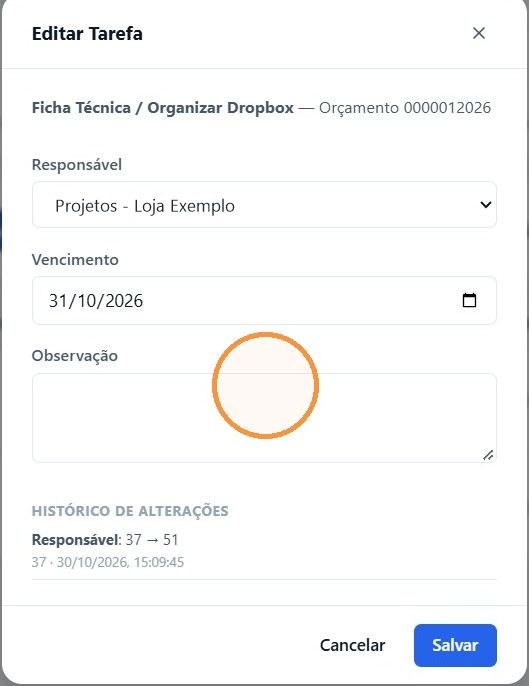
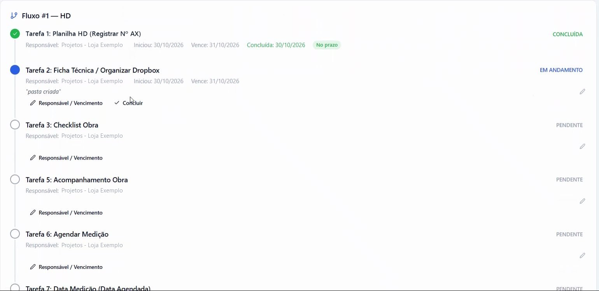

## Antes de começar

- Permissão necessária: **Orçamentos › Editar**. Para mudar o responsável e o vencimento, também **Fluxos P.Venda › Editar**.
- Só a tarefa **EM ANDAMENTO** pode ser concluída. As tarefas **PENDENTE** começam uma de cada vez, conforme as anteriores são concluídas.

## Concluir a tarefa

1. Em **Comercial › Fluxo de Venda**, encontre a tarefa. Veja [Ver as tarefas de pós-venda](/decor/fluxos/ver-minhas-tarefas/).
2. No fim da linha, clique no ícone verde **Concluir tarefa**.

   

3. Na janela **Concluir Tarefa**, escreva em **Observação (opcional)**, se quiser, e clique em **Confirmar Conclusão**.

   

4. Aparece **Operação realizada com sucesso!**, e a linha passa para a próxima tarefa do fluxo.

   

Também dá para concluir pela tela do fluxo no orçamento, no botão **Concluir** da tarefa.

## Resultado esperado

- A tarefa fica **CONCLUÍDA**, com a data e a indicação **No prazo** ou com atraso.
- A tarefa seguinte começa na hora. O vencimento dela é calculado nesse momento: a data da conclusão mais os dias definidos no modelo do fluxo.
- Se a tarefa seguinte tiver outro responsável, o fluxo sai da sua lista com **Apenas minhas** marcado e passa para a pessoa seguinte.

## Mudar o responsável ou o vencimento

1. Na linha da tarefa, clique no lápis **Editar responsável / vencimento**.
2. Na janela **Editar Tarefa**, altere o **Responsável** ou o **Vencimento**, escreva a **Observação**, se precisar, e clique em **Salvar**. Em **Histórico de Alterações** fica o que já mudou.

   

> **Atenção:** o vencimento de uma tarefa **PENDENTE** é calculado de novo quando ela começa. Se você mudar a data de uma tarefa que ainda não começou, ela é substituída. Ajuste o vencimento quando a tarefa estiver **EM ANDAMENTO**. O responsável e a observação ficam como você deixou.

## Ver o fluxo completo

1. Na linha da tarefa, clique no primeiro ícone, **Ver fluxo no orçamento**.
2. A tela **Fluxos Pós-Venda** mostra todas as tarefas do fluxo, com os responsáveis, as datas e as observações.

   

3. Para sair, clique em **Voltar**.

## Se algo der errado

| Mensagem | O que fazer |
|---|---|
| "Tarefa ainda não está em andamento" | Conclua antes as tarefas anteriores do fluxo. |
| "Tarefa já foi concluída" | Outra pessoa já concluiu. Atualize a tela. |
