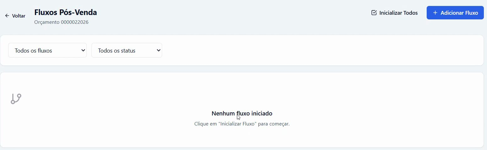
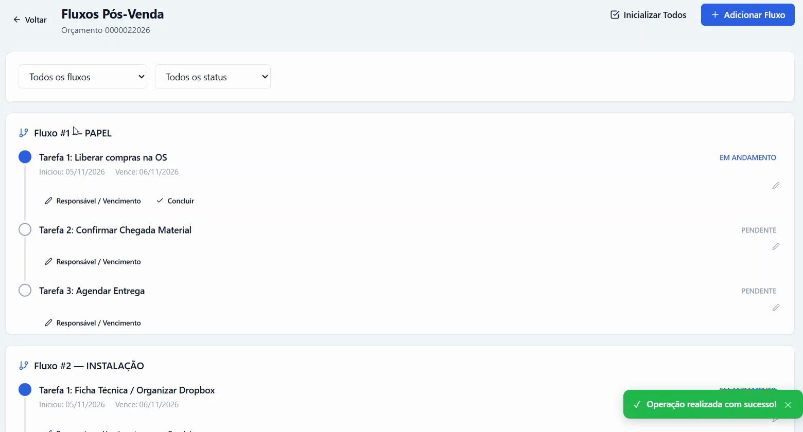
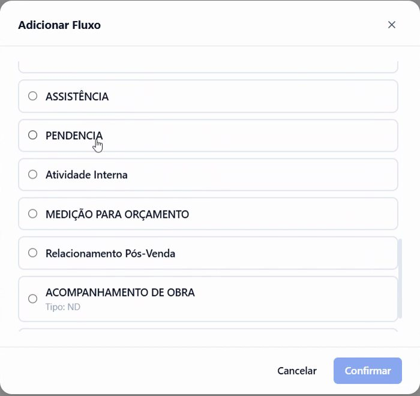
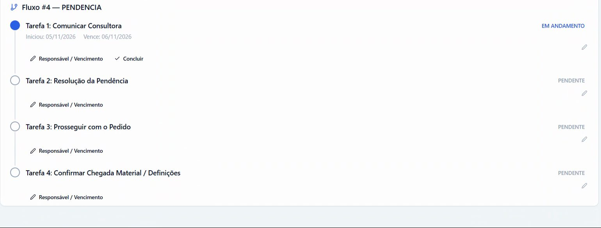
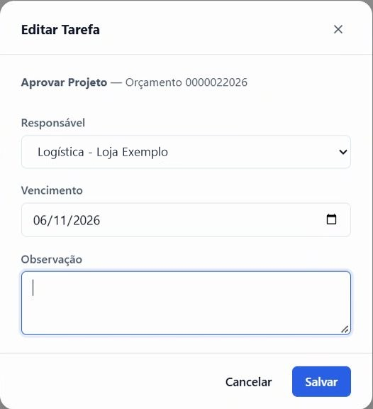
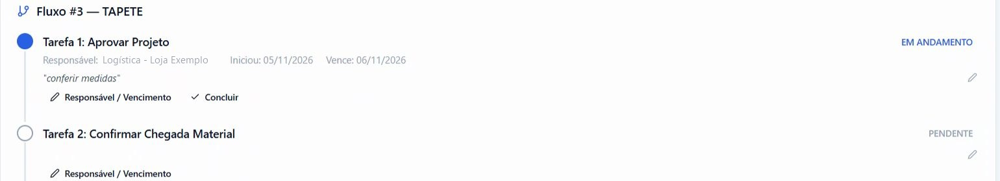

## Antes de começar

- Permissão necessária: **Orçamentos › Editar**. Para mudar o responsável e o vencimento, também **Fluxos P.Venda › Editar**.
- O orçamento precisa estar aprovado. Veja [Aprovar um orçamento](/decor/orcamentos/aprovar-orcamento/).
- Os modelos de fluxo, com as tarefas e os prazos de cada um, são cadastrados em **Administração › Fluxos P.Venda**.

## Iniciar os fluxos do orçamento

1. No orçamento aprovado, clique no ícone **Fluxos Pós-Venda**, no topo da tela, ao lado de **Criar OS**.

   

2. A tela abre com **Nenhum fluxo iniciado**: a aprovação não cria os fluxos sozinha.

   

3. Clique em **Inicializar Todos**. Aparece **Operação realizada com sucesso!**

## Resultado esperado

Cada tipo de produto do orçamento ganha o seu fluxo, com as tarefas em ordem. A primeira tarefa de cada fluxo fica **EM ANDAMENTO**, com início e vencimento, e as outras ficam **PENDENTE**.

As tarefas passam a aparecer em **Comercial › Fluxo de Venda**. Veja [Ver as tarefas de pós-venda](/decor/fluxos/ver-minhas-tarefas/).

## Acrescentar um fluxo avulso

Use para um fluxo que não depende do tipo de produto, como uma pendência ou uma atividade interna.

1. Clique em **+ Adicionar Fluxo**.
2. Na janela **Adicionar Fluxo**, marque o fluxo e clique em **Confirmar**.

   

3. O fluxo entra no fim da lista, com as suas tarefas.

   

## Definir responsável, vencimento e observação

1. Na tarefa, clique em **Responsável / Vencimento**.
2. Na janela **Editar Tarefa**, escolha o **Responsável** e o **Vencimento**, escreva a **Observação** e clique em **Salvar**.

   

3. A tarefa passa a mostrar o responsável, a observação, o início e o vencimento.

   

A observação fica embaixo do nome da tarefa, à vista de quem vai fazê-la. Use para deixar um recado para a próxima pessoa do fluxo.

## Se algo der errado

| Mensagem ou sintoma | O que fazer |
|---|---|
| "Nenhum fluxo aplicável para os itens deste orçamento" | Nenhum modelo de fluxo está ligado aos tipos de produto do orçamento. Use **+ Adicionar Fluxo** ou peça ao administrador para configurar os modelos em **Administração › Fluxos P.Venda**. |
| "Todos os fluxos aplicáveis já foram inicializados" | Os fluxos já existem. Clicar de novo em **Inicializar Todos** não cria fluxos repetidos. |
| A tela vazia pede para clicar em "Inicializar Fluxo" | O botão se chama **Inicializar Todos**, no topo da tela. |
| A janela **Adicionar Fluxo** diz "Nenhum fluxo cadastrado" | Ainda não há modelos de fluxo. Eles são criados em **Administração › Fluxos P.Venda**. |
