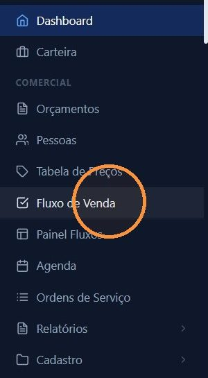
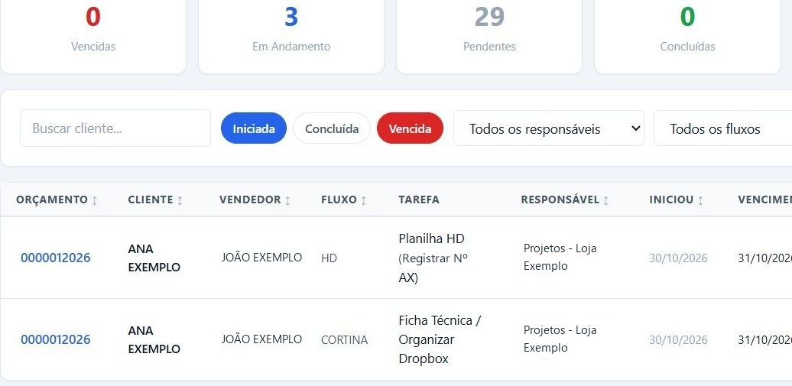
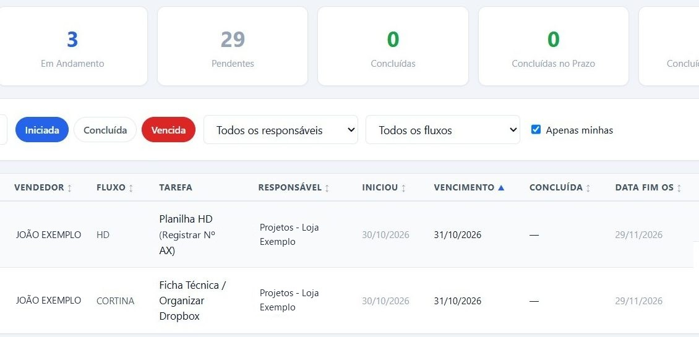

## Antes de começar

- Permissão necessária: **Fluxo de Venda › Visualizar**.

## Passo a passo

1. Acesse **Comercial › Fluxo de Venda**. Abre a tela **Tarefas Pós-Venda**.

   

2. No topo, os cartões mostram quantas tarefas estão **Vencidas**, **Em Andamento**, **Pendentes**, **Concluídas**, **Concluídas no Prazo** e **Concluídas com Atraso**.
3. Use os filtros **Iniciada**, **Concluída** e **Vencida**, a busca por cliente e a lista de fluxos.

   

4. Escolha de quem são as tarefas: um responsável na lista, **Todos os responsáveis** ou, marcando **Apenas minhas**, só as suas.

   

## O que cada coluna mostra

| Coluna | O que é |
|---|---|
| **Orçamento**, **Cliente** e **Vendedor** | De qual venda é a tarefa. |
| **Fluxo** | O fluxo a que a tarefa pertence. |
| **Tarefa** e **Responsável** | O que precisa ser feito e quem faz. A observação aparece embaixo do nome da tarefa. |
| **Iniciou** e **Vencimento** | Quando a tarefa começou e o prazo dela. |
| **Data Fim OS** | A data final da ordem de serviço. |

## Dicas

- **O mesmo orçamento pode ter várias linhas.** Cada linha é um fluxo aberto, com a tarefa da vez.
- **Comece o dia por aqui.** Com **Apenas minhas** e o filtro **Vencida**, você vê primeiro o que está atrasado.
- Nos ícones do fim da linha, você abre o fluxo no orçamento, muda o responsável ou o vencimento e conclui a tarefa. Veja [Concluir uma tarefa do fluxo](/decor/fluxos/concluir-tarefa/).
