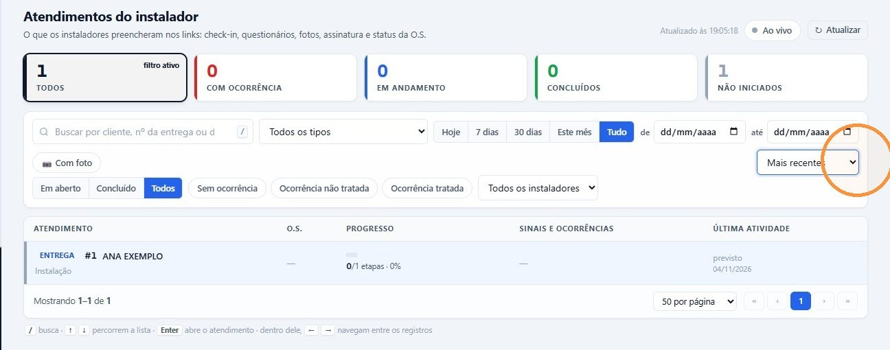
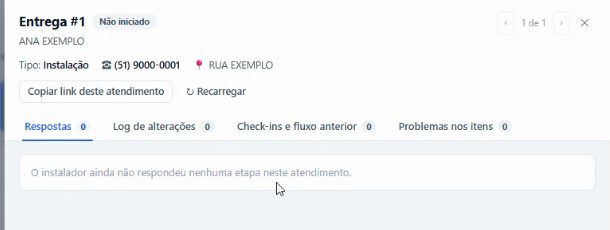

## Antes de começar

- Permissão necessária: **Atendimentos › Visualizar**. Para marcar a ocorrência como tratada, **Painel de Entregas › Editar**.
- O instalador recebe o link quando a entrega é criada. Veja [Criar a entrega e o link do instalador](/decor/logistica/criar-entrega/).

## Passo a passo

1. Abra **Logística › Atendimentos**. A tela mostra o que os instaladores preencheram nos links: check-in, questionários, fotos, assinatura e status da O.S. Com **Ao vivo** ligado, ela se atualiza sozinha.
2. Nos cartões do topo, clique em **Com ocorrência**, **Em andamento**, **Concluídos** ou **Não iniciados** para filtrar.
3. Se precisar, refine a lista:
   - busca por cliente ou número da entrega, e o tipo de atendimento;
   - período: **Hoje**, **7 dias**, **30 dias**, **Este mês**, **Tudo** ou as datas **de** e **até**;
   - **Em aberto**, **Concluído** ou **Todos**;
   - **Sem ocorrência**, **Ocorrência não tratada** ou **Ocorrência tratada**;
   - **Com foto** e o instalador;
   - a ordem da lista, como **Mais recentes**.

   

4. Clique no atendimento para abrir os detalhes. No topo aparecem o tipo, a O.S., o telefone e o endereço do cliente.

   

5. Confira as abas:
   - **Respostas:** o que o instalador respondeu no checklist;
   - **Log de alterações:** o que mudou no atendimento;
   - **Check-ins e fluxo anterior:** os check-ins e as visitas anteriores;
   - **Problemas nos itens:** os itens que ele não conseguiu entregar ou instalar, com o motivo.

Use **‹** e **›** para passar ao atendimento anterior ou ao próximo, e **Copiar link deste atendimento** para mandar o atendimento a um colega.

## Tratar uma ocorrência

Quando o instalador informa uma ocorrência ou um problema num item, o atendimento aparece com o alerta **!**.

1. Fale com o cliente, explique a situação e combine a solução e a data do retorno. Para agendar o retorno, veja [Concluir a entrega ou tratar uma pendência](/decor/logistica/concluir-entrega/).
2. Resolvido o caso, abra o atendimento e clique em **✓ Ocorrência tratada — concluir**.
3. Se quiser, escreva como foi tratada e clique em **Confirmar — ocorrência tratada**.

A visita é concluída no Cronograma, os problemas em aberto nos itens são resolvidos e o alerta sai do Cronograma, da O.S. e da tela de Atendimentos. O registro da ocorrência continua no histórico.

## O que o instalador responde

O link é o checklist da visita. As perguntas dependem do tipo de atendimento: em geral, se a instalação ficou correta, se o local foi limpo e se ficaram resíduos, quem foi o responsável, fotos, observações e pendências.

Se ele ainda não respondeu, a aba **Respostas** mostra **O instalador ainda não respondeu nenhuma etapa neste atendimento**.
