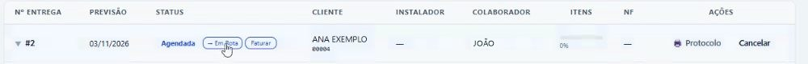
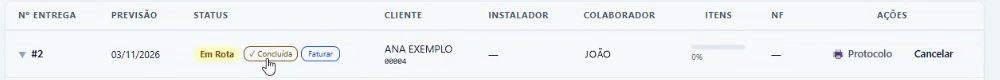
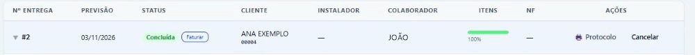

## Antes de começar

- Permissões necessárias: **Painel de Entregas › Editar**, para marcar **Em Rota**, e **Painel de Entregas › Concluir**, para concluir.

## Passo a passo

1. Em **Logística › Painel de Entregas**, abra a aba **Entregas**. Informe o período ou o cliente e clique em **Buscar**.
2. Na coluna **Status**, veja se a entrega está **Agendada**, **Em Rota** ou **Concluída**.
3. Quando a equipe sair, clique em **→ Em Rota**.

   

4. Com a entrega feita, clique em **✓ Concluída**.

   

## Resultado esperado

O status passa para **Concluída**, e a barra da coluna **Itens** vai a 100%.

## Conclusão pelo link do instalador

Quando o instalador responde o checklist pelo link e marca todos os itens como entregues, a entrega passa sozinha para **Concluída**. Não é preciso clicar em **✓ Concluída**.

Se ele informa um problema num item, a entrega não é concluída. Ela fica **Em Rota**, e a barra da coluna **Itens** mostra o alerta ⚠️ com o número de itens com problema. Ao abrir a entrega, o quadro **Problemas reportados nos itens** mostra o motivo e a observação de cada um.

## Quando fica uma pendência

Por exemplo: de duas peças, uma não pôde ser instalada.

1. Veja o que o instalador informou. Veja [Acompanhar o atendimento do instalador](/decor/logistica/acompanhar-atendimento-do-instalador/).
2. Entre em contato com o cliente, explique a situação e combine a solução e a data do retorno.
3. Para agendar o retorno, abra a aba **Cronograma**, clique em **+ Agendar** e escolha essa entrega. A nova visita fica ligada à mesma entrega e ao mesmo protocolo.

> **Atenção:** o botão **✓ Concluída** marca **todos** os itens da entrega como entregues, inclusive os que ficaram pendentes. Se ficou alguma pendência, não use esse botão: deixe a entrega aberta até resolver.

## Outras ações da entrega

- **Protocolo:** abre o protocolo de entrega para imprimir.
- **Faturar:** gera a nota fiscal da entrega (NF-e ou NFC-e) como rascunho, para conferir e transmitir em **Fiscal › Monitor Fiscal**. Aparece enquanto a entrega não tem nota vinculada.
- **Cancelar:** cancela a entrega.
