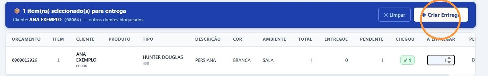
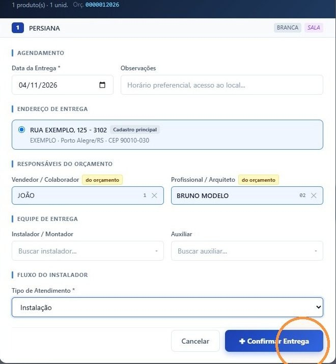
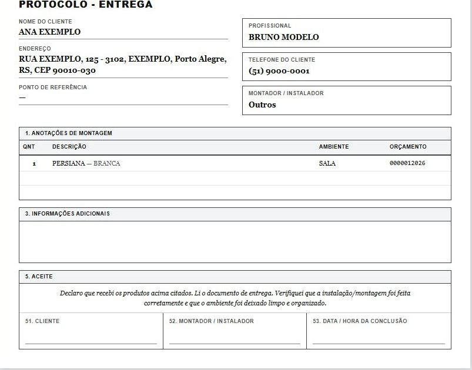
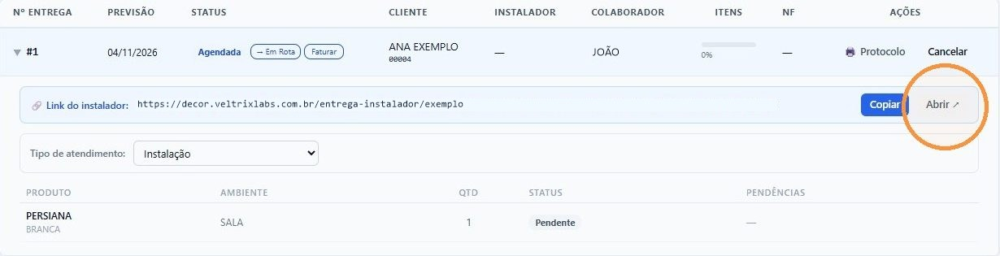

## Antes de começar

- Permissão necessária: **Painel de Entregas › Criar**.
- A chegada do material precisa estar registrada no pedido de compra. Veja [Registrar a chegada da nota de compra](/decor/compras/registrar-chegada/).
- Combine a data com o cliente ou com o arquiteto antes de criar a entrega. No fluxo de pós-venda, isso corresponde às tarefas de confirmar a disponibilidade e agendar a instalação. Veja [Acompanhar a produção e o transporte](/decor/fluxos/acompanhar-producao-e-transporte/).

## Passo a passo

1. Em **Logística › Painel de Entregas**, aba **Pendentes de Entrega**, busque o período e clique em **Só chegados**.
2. Na coluna **A Entregar**, digite a quantidade de cada item que vai nesta entrega. Os itens selecionados aparecem na faixa azul, e os de outros clientes ficam bloqueados.
3. Clique em **✚ Criar Entrega**.

   

4. Na janela, preencha:
   - **Data da Entrega** e, se precisar, **Observações**, como horário preferido ou acesso ao local;
   - o **Endereço de Entrega**: confira ou escolha outro endereço do cliente;
   - em **Responsáveis do Orçamento**, confira o **Vendedor / Colaborador** e o **Profissional / Arquiteto**, que já vêm do orçamento;
   - em **Equipe de Entrega**, o **Instalador / Montador** e o **Auxiliar**;
   - o **Tipo de Atendimento**, por exemplo **Instalação**.

   

5. Clique em **✚ Confirmar Entrega**.

## Resultado esperado

- O protocolo de entrega abre na tela, com o cliente, o endereço, o profissional, o instalador e os itens. No fim, traz o aceite: o cliente declara que recebeu os produtos, que a instalação foi feita corretamente e que o ambiente ficou limpo e organizado.

  

- A entrega aparece na aba **Entregas**, com o status **Agendada**, e no **Cronograma**.
- É criado o link do instalador.

## Encontrar o link do instalador

1. Na aba **Entregas**, informe o período ou o cliente e clique em **Buscar**.
2. Clique na entrega para abrir os detalhes. O **Link do instalador** aparece com os botões **Copiar** e **Abrir**. Copie e mande ao instalador.

   

Na mesma linha, em **Ações**, o botão **Protocolo** abre o protocolo de novo para imprimir.

O link é o checklist do instalador. O **Tipo de Atendimento** define as perguntas que ele responde: se a instalação ficou correta, se o local foi limpo, quem foi o responsável, fotos, observações e pendências. Para ver as respostas, siga [Acompanhar o atendimento do instalador](/decor/logistica/acompanhar-atendimento-do-instalador/).

## Dicas

- **Uma entrega é de um cliente só.** Para atender outro cliente, clique em **✕ Limpar** e selecione os itens dele.
- **Dá para entregar só parte.** Digite em **A Entregar** a quantidade que vai agora. O resto continua pendente.
- **O instalador precisa estar cadastrado.** Se a busca não encontra o instalador, peça o cadastro em **Comercial › Cadastro › Instaladores**. Sem instalador, o protocolo sai com **Outros**.
- Os tipos de atendimento são cadastrados em **Comercial › Cadastro › Tipos de Atendimento**.

## Se algo der errado

| Sintoma | O que fazer |
|---|---|
| O botão **✚ Confirmar Entrega** fica cinza | Escolha o **Tipo de Atendimento**. |
| Não consigo digitar em **A Entregar** | Passe o mouse sobre o campo para ver o motivo. Veja [Usar o Painel de Entregas](/decor/logistica/painel-de-entregas/). |
