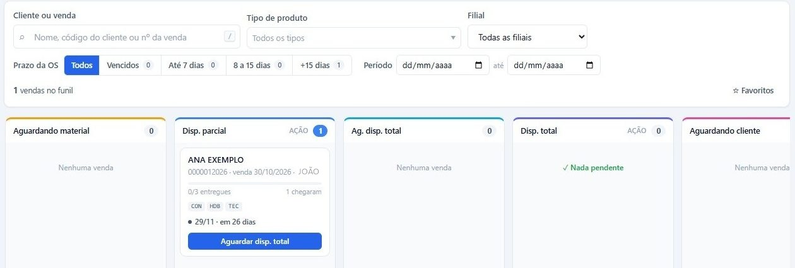
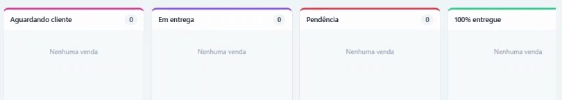
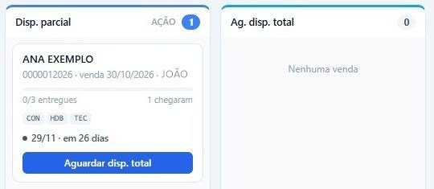

## Antes de começar

- Permissão necessária: **Funil de Entregas › Visualizar**. Para usar os botões dos cartões, **Painel de Entregas › Editar**.

## Passo a passo

1. Abra **Logística › Funil de Entregas**. Cada coluna é uma etapa, e cada cartão é uma venda.

   

2. No cartão, veja o cliente, o orçamento, a data da venda, o vendedor, quantos itens foram entregues, quantos chegaram, os tipos de produto e o prazo.
3. Para filtrar, use **Prazo da OS** (**Vencidos**, **Até 7 dias**, **8 a 15 dias** ou **+15 dias**), **Cliente ou venda**, **Tipo de produto**, **Filial** e **Período**.

## O que cada coluna quer dizer

| Coluna | Quer dizer |
|---|---|
| **Aguardando material** | O material foi pedido e ainda não chegou. |
| **Disp. parcial** | Parte dos itens chegou. Dá para entregar o que chegou ou esperar o resto. |
| **Ag. disp. total** | O cliente prefere receber tudo junto. A venda espera os outros itens chegarem. |
| **Disp. total** | Tudo chegou. Falta agendar a entrega. |
| **Aguardando cliente** | Está tudo disponível, mas o cliente ainda não quer receber, por exemplo porque está em obra. |
| **Em entrega** | A entrega já foi criada. |
| **Pendência** | Ficou algo para resolver na entrega, como um item a trocar, uma cor errada ou um atraso. |
| **100% entregue** | A venda foi entregue por completo. |

A marca **AÇÃO** em **Disp. parcial** e **Disp. total** indica as colunas que pedem uma providência da logística: agendar ou esperar.

## Quando o cliente quer receber tudo junto

Com a venda em **Disp. parcial**, clique em **Aguardar disp. total** no cartão. A venda passa para **Ag. disp. total**.

Para desfazer, clique em **Desmarcar** no cartão. A venda volta para **Disp. parcial**.

## Quando o cliente ainda não quer receber

1. Com a venda em **Disp. total**, clique em **Aguardando cliente** no cartão.
2. Informe a **Nova data fim da OS**, a data em que o cliente quer receber, e clique em **✓ Confirmar**.

A data substitui a data fim da OS e passa a ser o prazo do cartão. A venda sai de **Aguardando cliente** quando o protocolo de entrega é emitido. Para desfazer antes disso, clique em **Desmarcar**.

## Dica

Use **Prazo da OS** em **Vencidos** e **Até 7 dias** para ver primeiro as vendas com prazo vencido ou perto de vencer.
