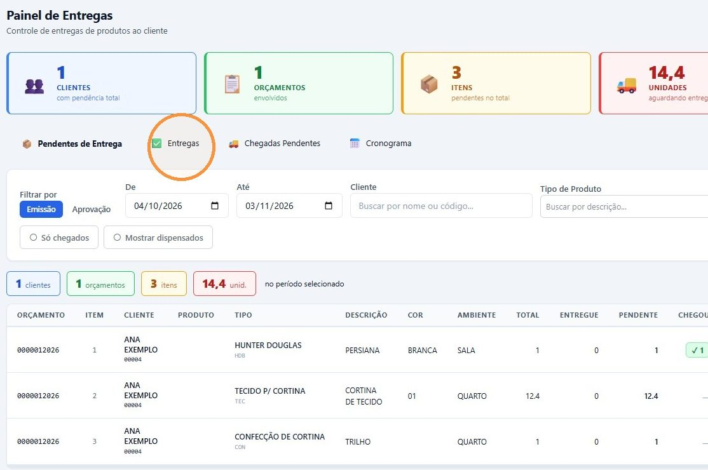
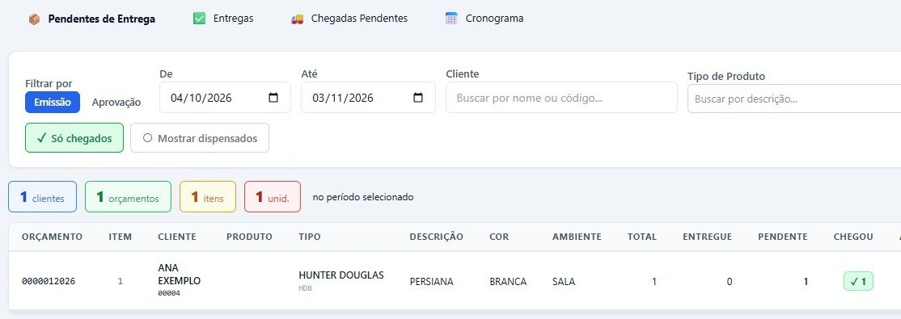
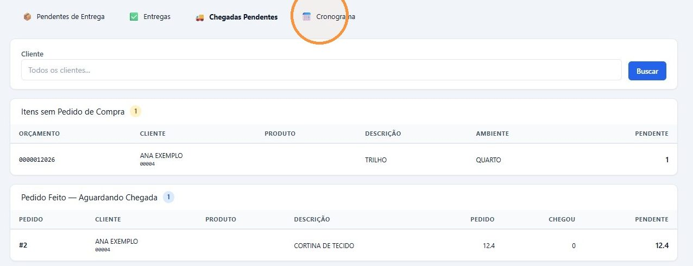
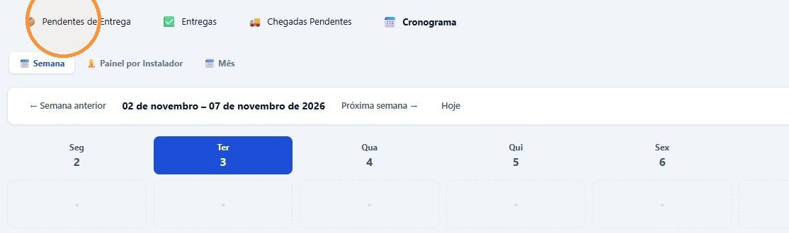

## Antes de começar

- Permissão necessária: **Painel de Entregas › Listar**.

## As abas do painel

| Aba | O que mostra |
|---|---|
| **Pendentes de Entrega** | Os itens vendidos que ainda faltam entregar. É daqui que se cria a entrega. |
| **Entregas** | As entregas já criadas, com status, instalador, itens entregues e nota fiscal. |
| **Chegadas Pendentes** | O que ainda não chegou, em dois quadros: **Itens sem Pedido de Compra** e **Pedido Feito — Aguardando Chegada**. |
| **Cronograma** | As entregas agendadas, nas visões **Semana**, **Painel por Instalador** e **Mês**. |

## Ver o que falta entregar

1. Em **Logística › Painel de Entregas**, fique na aba **Pendentes de Entrega**.
2. Em **Filtrar por**, escolha se o período vale pela data de **Emissão** ou de **Aprovação** do orçamento. Informe **De** e **Até** e, se quiser, o **Cliente** e o **Tipo de Produto**.
3. Clique em **Buscar**.

   

4. Para ver só o que já chegou, clique em **Só chegados**.

   

A lista mostra, por item, o **Total**, o que já foi **Entregue**, o **Pendente** e, em **Chegou**, quanto já chegou. Acima dela, o resumo mostra quantos clientes, orçamentos, itens e unidades estão no período.

Para criar a entrega dos itens que chegaram, siga [Criar a entrega e o link do instalador](/decor/logistica/criar-entrega/).

## Ver o que ainda não chegou

Clique na aba **Chegadas Pendentes** e em **Buscar**. Se quiser, filtre pelo cliente.

- **Itens sem Pedido de Compra:** o item ainda não foi pedido ao fornecedor. Veja [Ver o que precisa ser comprado](/decor/compras/ver-o-que-comprar/).
- **Pedido Feito — Aguardando Chegada:** o pedido de compra foi feito, e o material ainda não chegou.

## Ver o cronograma

Clique na aba **Cronograma**. Na visão **Semana**, use **← Semana anterior**, **Próxima semana →** e **Hoje** para navegar. **Painel por Instalador** mostra a agenda de cada instalador, e **Mês**, o mês inteiro.

## Dispensar um item da pendência

Quando um item não vai mais ser entregue, quem tem a permissão **Painel de Entregas › Dispensar** pode tirá-lo da lista:

1. Na linha do item, na coluna **Pendência**, clique em **Dispensar** e confirme.
2. O item deixa de aparecer como pendente. As quantidades não mudam.

Para ver de novo os itens dispensados, clique em **Mostrar dispensados**. Esse botão aparece para quem tem **Painel de Entregas › Editar**.

## Por que não consigo selecionar o item?

Passe o mouse sobre o campo **A Entregar** do item para ver o motivo:

| Motivo | O que quer dizer |
|---|---|
| Item ainda não chegou | O pedido de compra existe, mas a chegada não foi registrada. |
| Item sem baixa em pedido de compra | O item não está em nenhum pedido de compra. |
| Tudo o que chegou já está em protocolo — aguardando nova chegada | O que chegou já está numa entrega criada. |
| Chegou só parte — disponível para entrega: N | Dá para entregar só a quantidade que chegou. |
| Finalize ou limpe a seleção do cliente … | Já há itens de outro cliente selecionados. Uma entrega é de um cliente só. |
| Item dispensado da pendência | O item foi dispensado. |
