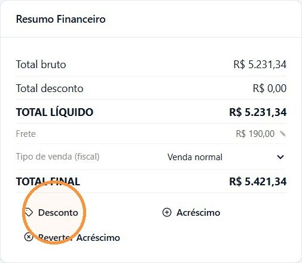
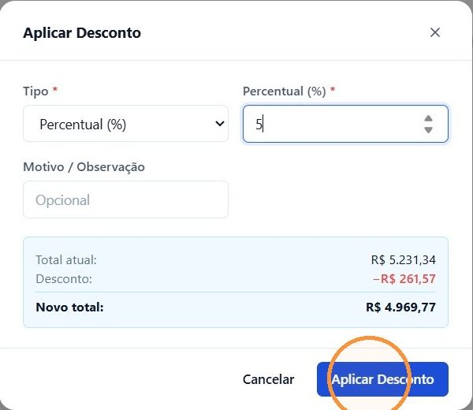
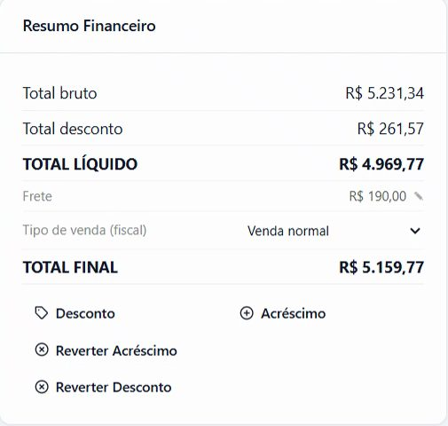
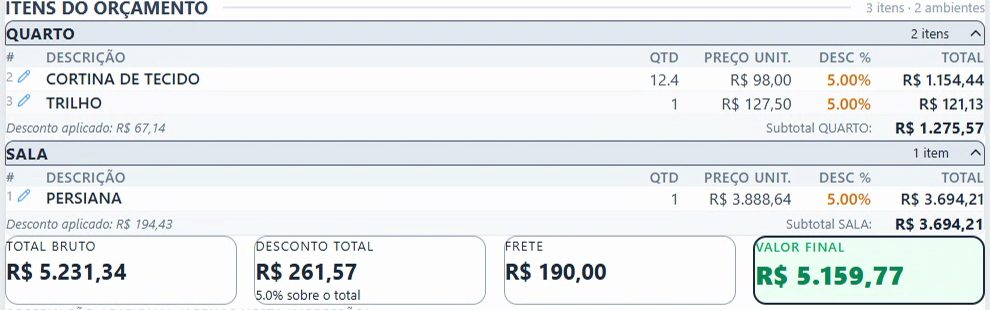

## Antes de começar

- Permissão necessária: **Orçamentos › Editar**.
- O orçamento precisa estar **Aberto** e ter itens.
- Acima de um limite, o desconto ou o acréscimo pode precisar de autorização de um responsável. Os limites ficam em **Administração › Regras de Autorização**.

## Passo a passo

1. Abra o orçamento em **Comercial › Orçamentos**.
2. No quadro **Resumo Financeiro**, clique em **Desconto** ou em **Acréscimo**.

   

3. Em **Tipo**, escolha **Percentual (%)** ou **Valor (R$)** e informe o número.
4. Se quiser, explique em **Motivo / Observação**.
5. Confira **Total atual**, o valor do desconto ou do acréscimo e o **Novo total**.
6. Clique em **Aplicar Desconto** ou **Aplicar Acréscimo**.

   

7. Se aparecer **Aguardando autorização**, o pedido foi para o autorizador, que recebe um token de 6 dígitos pelo WhatsApp. Você pode:
   - aguardar o autorizador aprovar em **Administração › Autorizações**; ou
   - clicar em **Tenho o token**, digitar o token que o autorizador passar e clicar em **Confirmar com Token**.

## Resultado esperado

O desconto ou o acréscimo é aplicado em **todos os itens**, e os totais do **Resumo Financeiro** são recalculados. Aparece o botão **Reverter Desconto** ou **Reverter Acréscimo**. Cada aplicação fica registrada no **Histórico** do orçamento.

No **PDF / Preview**, cada item mostra o percentual de desconto, e o total mostra o desconto sobre o valor do orçamento.

## Como o cálculo funciona

- **Desconto:** o mesmo percentual vai para todos os itens. Um desconto em valor (R$) vira o percentual equivalente sobre o total bruto. Um desconto aplicado aqui **substitui** o **Desc. %** que cada item tinha.
- **Frete:** fica fora do desconto. O desconto é calculado sobre o total dos itens, e o frete entra depois, no **TOTAL FINAL**.
- **Acréscimo:** aumenta o **Preço Unit.** de cada item. O preço original fica guardado para poder ser restaurado. O desconto de cada item continua valendo sobre o novo preço.

## Desfazer

- **Reverter Desconto** zera o desconto de todos os itens.
- **Reverter Acréscimo** volta todos os itens ao preço original.

Os dois botões aparecem no **Resumo Financeiro** só quando há desconto ou acréscimo nos itens.

## Se algo der errado

| Mensagem ou sintoma | O que fazer |
|---|---|
| Os botões **Desconto** e **Acréscimo** não aparecem | O orçamento não está **Aberto**, ou falta a permissão **Orçamentos › Editar**. |
| "Orçamento sem itens" | Lance os itens antes de aplicar o desconto ou o acréscimo. |
| "Solicitação não aprovada" | O autorizador ainda não aprovou ou recusou o pedido. Fale com ele ou peça o token. |
| "Token inválido" | Confira os 6 dígitos com o autorizador e digite de novo. |
