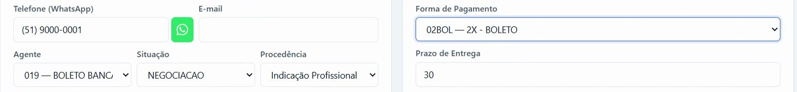
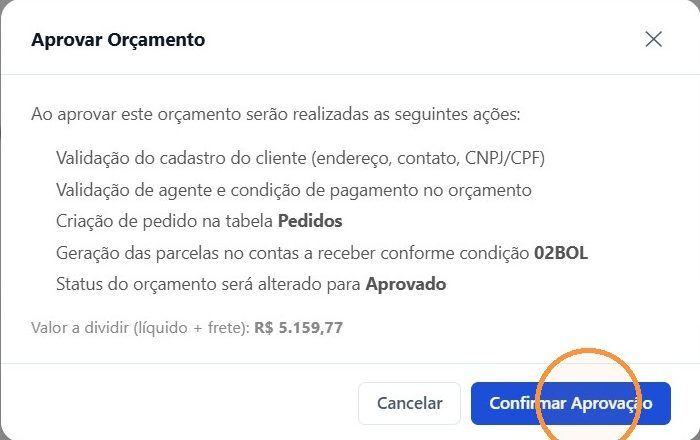
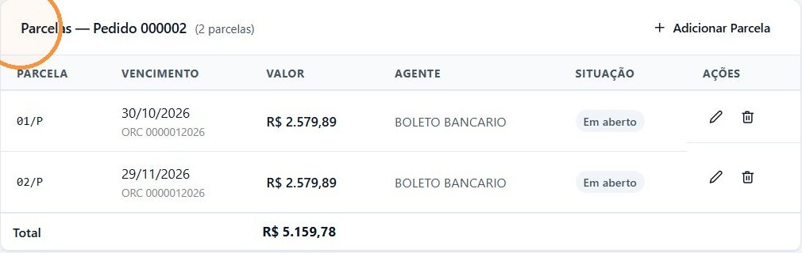
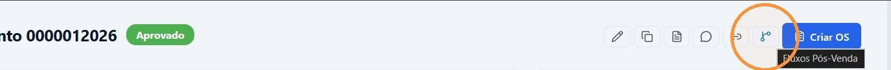
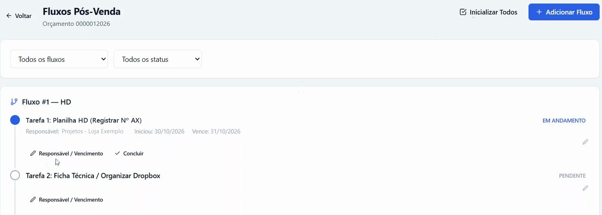

## Antes de começar

- Permissão necessária: **Orçamentos › Editar**.
- O orçamento precisa estar **Aberto**, na situação **Negociação**, e ter **Agente**, **Forma de Pagamento** e **Prazo de Entrega** preenchidos.
- O cadastro do cliente, em **Comercial › Pessoas**, precisa ter CNPJ ou CPF, endereço e ao menos um contato (telefone, celular ou e-mail).
- O frete precisa estar lançado. As parcelas são calculadas sobre o total líquido **mais o frete**.
- Revise os itens: medidas, cor e especificações. É a partir do orçamento aprovado que a compra é feita.

## Passo a passo

1. Abra o orçamento em **Comercial › Orçamentos**.
2. Clique em **Editar** e confira:
   - **Situação** em **Negociação**. Veja [Mudar a situação do orçamento](/decor/orcamentos/mudar-situacao/);
   - **Agente** e **Forma de Pagamento** de acordo com o combinado. Por exemplo, agente **BOLETO BANCARIO** e forma **2X - BOLETO** para duas parcelas no boleto.

   Clique em **Salvar Alterações**.

   

3. Confira o **TOTAL FINAL** no **Resumo Financeiro**. Para lançar ou corrigir o frete, clique no lápis ao lado de **Frete**, informe o tipo (ex.: CIF) e o valor e clique em **Salvar**.
4. Em **Alterar Status**, clique em **✓ Aprovar**.
5. A janela **Aprovar Orçamento** mostra o que vai acontecer e o **Valor a dividir (líquido + frete)**. Clique em **Confirmar Aprovação**.

   

6. Se aparecer **Não foi possível aprovar:**, corrija cada item da lista e clique em **Tentar Novamente**. Veja o que cada mensagem significa em [Não consigo aprovar ou liberar o orçamento](/decor/orcamentos/erro-nao-consigo-aprovar-ou-liberar/).
7. Em **✓ Orçamento aprovado com sucesso!**, anote o número em **Pedido gerado** e clique em **Fechar**.

## Resultado esperado

- O status passa para **Aprovado** e a situação para **Fechado**.
- É criado um pedido, e as parcelas entram no contas a receber. Os percentuais e os prazos vêm da **Forma de Pagamento**, e os vencimentos contam a partir da data da aprovação.
- O quadro **Parcelas — Pedido …** aparece no orçamento.

  

- Os próximos passos são [iniciar os fluxos de pós-venda](#iniciar-os-fluxos-de-pos-venda) e [criar a O.S. e liberar o orçamento](/decor/orcamentos/liberar-e-faturar/).

## Iniciar os fluxos de pós-venda

A aprovação não cria as tarefas de pós-venda sozinha. Inicie os fluxos logo depois de aprovar:

1. No orçamento aprovado, clique no ícone **Fluxos Pós-Venda**, no topo da tela.

   

2. Clique em **Inicializar Todos**. O sistema cria os fluxos previstos para os tipos de produto do orçamento, cada um com as suas tarefas. Para incluir um fluxo avulso, use **+ Adicionar Fluxo**.
3. Na tarefa em andamento, clique em **Responsável / Vencimento**, confira quem cuida dela e o prazo, e clique em **Salvar**.

   

As tarefas passam a aparecer em **Comercial › Fluxo de Venda**, para quem for responsável por elas. O passo a passo completo está em [Iniciar os fluxos de pós-venda de um orçamento](/decor/fluxos/iniciar-fluxos/).

| Mensagem | O que significa |
|---|---|
| "Nenhum fluxo aplicável para os itens deste orçamento" | Nenhum fluxo está configurado para os tipos de produto do orçamento. Use **+ Adicionar Fluxo** ou peça ao administrador para configurar os fluxos em **Administração › Fluxos P.Venda**. |
| "Todos os fluxos aplicáveis já foram inicializados" | Os fluxos já foram criados. Não é preciso fazer nada. |

## Ajustar as parcelas

Enquanto o orçamento está **Aprovado**, as parcelas que ainda não foram pagas podem ser ajustadas no quadro **Parcelas**:

- **Editar parcela** (lápis): muda **Valor (R$)**, **Vencimento**, **Agente** e **Observação**.
- **Excluir parcela** (lixeira): aparece quando há mais de uma parcela.
- **Adicionar Parcela**: lança uma parcela com a diferença que falta para fechar o total.

Se a soma das parcelas não bater com o total do orçamento mais o frete, aparece um aviso em laranja. Com essa diferença, o orçamento **não pode ser liberado nem faturado**.

## Boleto das parcelas

Com a permissão **Orçamentos › Emitir/imprimir boleto das parcelas**, a parcela em aberto ganha o ícone **Gerar boleto**, desde que o agente dela tenha convênio bancário. Depois de gerado, use **Imprimir boleto** e o ícone de envio para mandar o boleto ao cliente por e-mail.

## Se algo der errado

| Mensagem ou sintoma | O que fazer |
|---|---|
| O botão **✓ Aprovar** não aparece | O orçamento não está **Aberto**, ou falta a permissão **Orçamentos › Editar**. |
| "Não é possível editar uma parcela já paga" | A parcela já foi recebida. Ajuste as outras parcelas. |
| "A soma das parcelas já atinge ou ultrapassa o total do orçamento — não há diferença a lançar" | Não falta valor. Para reduzir, edite ou exclua uma parcela. |
| "O pedido precisa ter ao menos uma parcela" | Não dá para excluir a última parcela. Edite o valor dela. |
