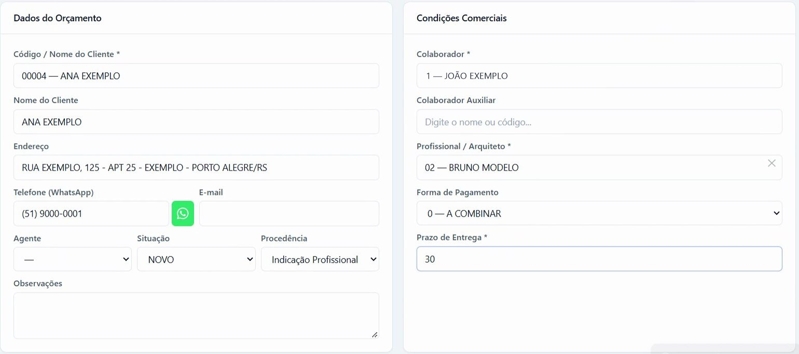
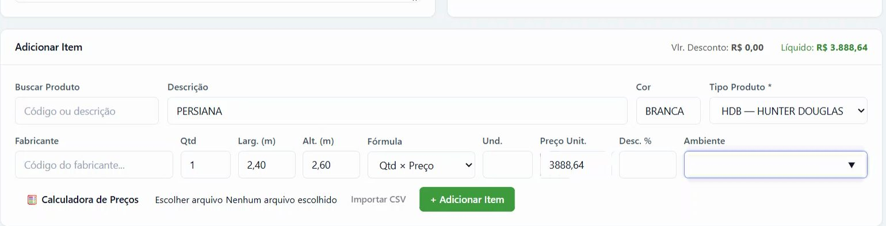
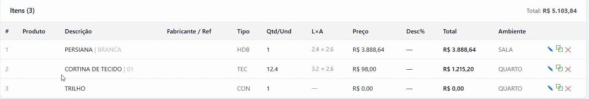
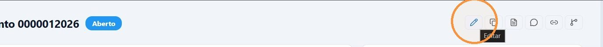
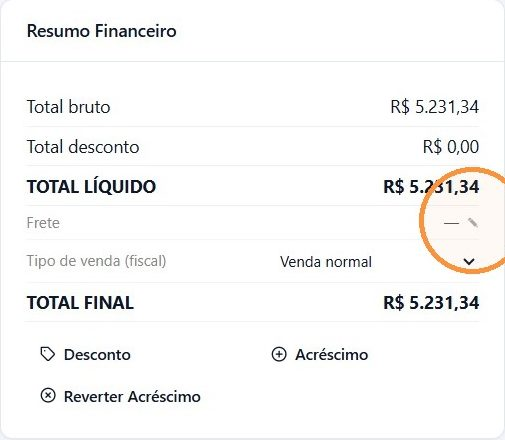
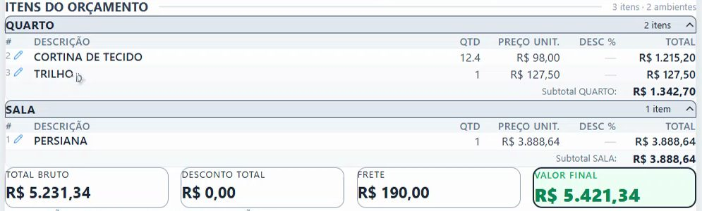

## Antes de começar

- Permissão necessária: **Orçamentos › Criar**.
- O colaborador e o profissional (arquiteto ou decorador) precisam estar cadastrados.
- Para puxar o preço da tabela, o fabricante precisa ter itens em **Comercial › Tabela de Preços**.

## Passo a passo

1. Acesse **Comercial › Orçamentos** e clique em **+ Novo Orçamento**.

   

2. Em **Dados do Orçamento**, digite o código ou o nome em **Código / Nome do Cliente** e escolha na lista. **Nome do Cliente**, **Endereço**, **Telefone (WhatsApp)** e **E-mail** vêm do cadastro e podem ser ajustados.
   - Se o cliente ainda não existe, clique em **+ Cadastrar cliente "…"**. O cliente é criado só com o nome. Complete o cadastro em **Comercial › Pessoas** antes de aprovar.
3. Se quiser, preencha **Agente**, **Situação**, **Procedência** e **Observações**. A **Procedência** registra como o cliente chegou à loja, por exemplo por indicação de um profissional ou passando na loja. Vale preencher sempre.
4. Em **Condições Comerciais**, informe:
   - **Colaborador**, que é o vendedor responsável pelo orçamento (obrigatório);
   - **Colaborador Auxiliar**, se outra pessoa participou da venda;
   - **Profissional / Arquiteto** (obrigatório). Se a venda não tem arquiteto, escolha o cadastro de profissional não identificado. Veja [Venda sem arquiteto](/decor/pessoas/cadastrar-profissional/#venda-sem-arquiteto);
   - **Forma de Pagamento**;
   - **Prazo de Entrega** (obrigatório).

   

5. Em **Adicionar Item**, lance cada item:
   1. Em **Buscar Produto**, digite o código ou a descrição e escolha o produto. Se o produto não existe no cadastro, preencha só a **Descrição**.
   2. Escolha o **Tipo Produto**. Sem ele, o botão **+ Adicionar Item** fica desabilitado. Os tipos são cadastrados pela loja em **Comercial › Cadastro › Tipos de Produto**.
   3. Para usar o preço do fabricante, digite o código em **Fabricante** e escolha na lista. A tabela de preços desse fabricante abre. Filtre por referência, descrição, cor, tamanho ou composição e clique na linha. **Referência**, **Cor**, **Und.** e **Preço Unit.** são preenchidos.
   4. Informe **Qtd**, **Larg. (m)** e **Alt. (m)** e confira a **Fórmula**:
      - **Qtd × Preço**: produtos vendidos por unidade. A largura e a altura ficam só como informação e não mudam o total;
      - **M² × Preço**: cortinas e persianas cobradas por área (largura × altura);
      - **M linear × Preço**: itens cobrados pela largura, como trilhos.
   5. Se houver desconto só neste item, informe **Desc. %**.
   6. Em **Ambiente**, escolha uma sugestão (Sala, Quarto, Suíte…) ou digite outro nome. Informe sempre o ambiente: na impressão, os itens saem agrupados por ambiente, com o subtotal de cada um.
   7. Confira **Vlr. Desconto** e **Líquido** no topo do quadro e clique em **+ Adicionar Item**.

   

6. Repita o passo 5 para cada item. Na tabela de itens, use os ícones de cada linha para **Editar**, **Duplicar item** ou **Remover**. Duplicar é útil para o mesmo produto em outro ambiente.

   

7. Confira o **Total** no topo da página e clique em **Salvar Orçamento**.

## Resultado esperado

O orçamento recebe um número e abre na tela de detalhe com o status **Aberto**. A partir daí você pode [aplicar desconto](/decor/orcamentos/aplicar-desconto-ou-acrescimo/), [enviar ao cliente](/decor/orcamentos/enviar-ao-cliente/) e [aprovar](/decor/orcamentos/aprovar-orcamento/).

## Alterar um orçamento

Enquanto o orçamento estiver **Aberto**, clique no ícone **Editar** (lápis) na lista ou no detalhe.

Na edição, cada item adicionado, alterado ou removido é gravado na hora. Os dados do orçamento, como cliente, situação, agente, forma de pagamento e prazo, só são gravados quando você clica em **Salvar Alterações**. Só a edição tem a opção **Importar CSV**, que lança vários itens de uma vez.

## Conferir antes de enviar

1. Se houver frete, lance no quadro **Resumo Financeiro**: clique no lápis ao lado de **Frete**, informe o valor e clique em **Salvar**. O frete entra no **TOTAL FINAL**.

   

2. Clique em **PDF / Preview** para ver o orçamento como o cliente vai receber. Os itens aparecem agrupados por ambiente.

   

3. Clique em **Voltar** para retornar ao orçamento.

## Outras formas de começar

- **Copiar** um orçamento existente: veja [Como fazer uma nova versão de um orçamento?](/decor/orcamentos/faq-nova-versao/).
- **Importar HD**: na lista, traz um orçamento feito no sistema do fabricante pelo número dele. Marque **Adicionar a um orçamento existente** para juntar os itens a um orçamento que já existe. Os itens que já estão no orçamento são atualizados e os novos são adicionados. Veja [Importar um orçamento da Hunter Douglas](/decor/orcamentos/importar-hunter-douglas/).

## Se algo der errado

| Mensagem ou sintoma | O que fazer |
|---|---|
| "Selecione um cliente da lista ou cadastre um novo antes de salvar." | O texto digitado não foi escolhido na lista. Escolha o cliente na lista ou clique em **+ Cadastrar cliente "…"**. |
| "Colaborador é obrigatório. Selecione um colaborador da lista." | Escolha o colaborador na lista. Só digitar o nome não basta. |
| "Profissional / Arquiteto é obrigatório." | Escolha o profissional na lista. |
| "Prazo de Entrega é obrigatório." | Preencha **Prazo de Entrega**. |
| O botão **+ Adicionar Item** não habilita | Falta a **Descrição** (ou o produto) ou o **Tipo Produto**. |
| "Orçamento aprovado, liberado, faturado ou cancelado não pode mais ser editado" | Só orçamento Aberto pode ser alterado. Veja [Posso alterar um orçamento já aprovado?](/decor/orcamentos/faq-alterar-aprovado/). |
