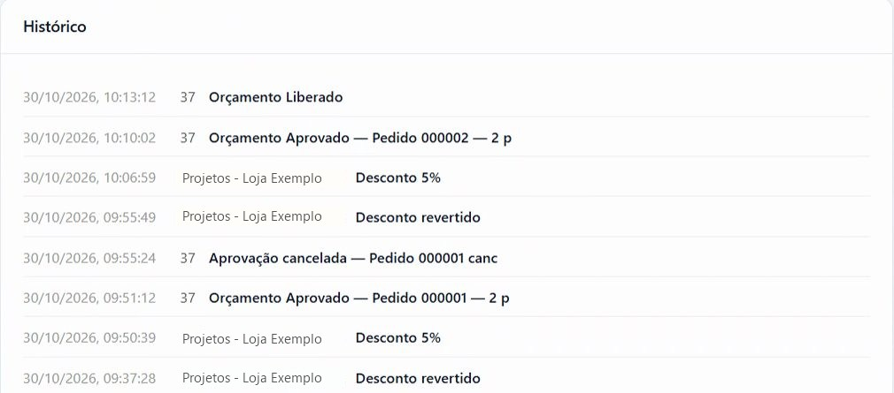

No bloco **Histórico**, no fim da tela do orçamento. Cada linha mostra a data, a hora, quem fez e o que foi feito: criação, desconto, desconto revertido, aprovação, cancelamento e liberação.

O bloco mostra os 5 registros mais recentes. Clique em **Ver histórico completo** para ver todos e em **Ver menos** para recolher.

