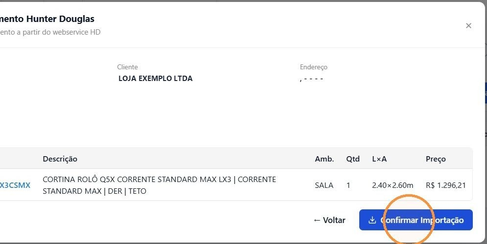
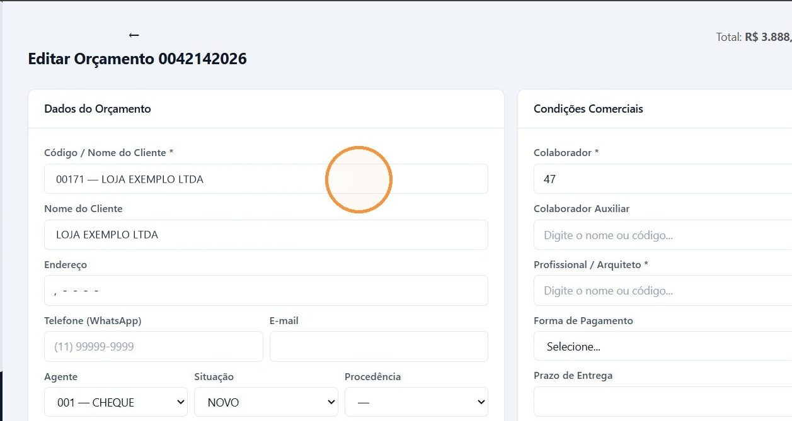
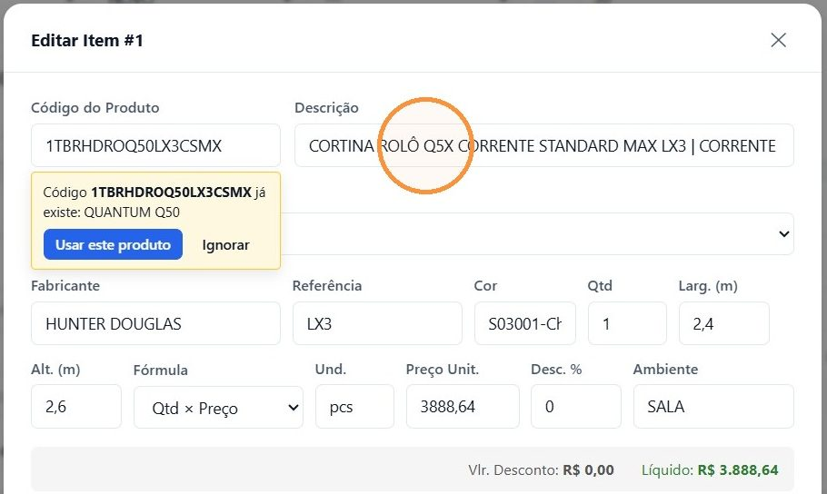

## Antes de começar

- Permissão necessária: **Orçamentos › Criar**.
- Tenha em mãos o **número do orçamento** gerado no sistema da Hunter Douglas.
- Confira se o cliente já está cadastrado em **Comercial › Pessoas**. Veja [Cadastrar um cliente](/decor/pessoas/cadastrar-cliente/).

## Passo a passo

1. Acesse **Comercial › Orçamentos** e clique em **Importar HD**.
2. Digite o **Número do Orçamento HD** e clique em **Consultar**.

   

3. Confira os itens encontrados e clique em **Confirmar Importação**.

   

4. Quando a importação terminar, clique em **Abrir Orçamento**.
5. Clique em **Editar**. O orçamento chega com a loja como cliente: em **Código / Nome do Cliente**, troque pelo seu cliente.

   

6. Preencha o que a importação não traz: **Agente**, **Colaborador**, **Colaborador Auxiliar**, **Profissional / Arquiteto**, **Forma de Pagamento** e **Prazo de Entrega**. Clique em **Salvar Alterações**.
7. Em cada item, clique em **Editar** e confira fabricante, tipo, quantidade, largura, altura, preço e ambiente.
8. Se quiser, troque a descrição técnica por uma mais simples para o cliente, por exemplo "Cortina rolô". Clique em **Salvar Item**.

   

9. Clique em **PDF / Preview** e confira como o orçamento sai para o cliente.

   

## Resultado esperado

O orçamento fica **Aberto**, com os itens da Hunter Douglas e os dados do seu cliente. A partir daqui, ele segue como qualquer orçamento: [mude a situação para Negociação](/decor/orcamentos/mudar-situacao/) e [aprove](/decor/orcamentos/aprovar-orcamento/).

## Adicionar a um orçamento existente

Na janela de importação, marque **Adicionar a um orçamento existente** para juntar os itens da Hunter Douglas a um orçamento que já existe. Os itens que já estão no orçamento são atualizados, e os novos são adicionados.

## Por que o preço muda depois de importar

Na consulta, a coluna **Preço** mostra o preço de fábrica da Hunter Douglas. No orçamento, o item entra com o preço ao consumidor, que vem no mesmo orçamento da Hunter Douglas. Por isso o valor no orçamento é maior que o da consulta.
