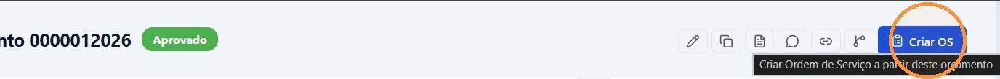
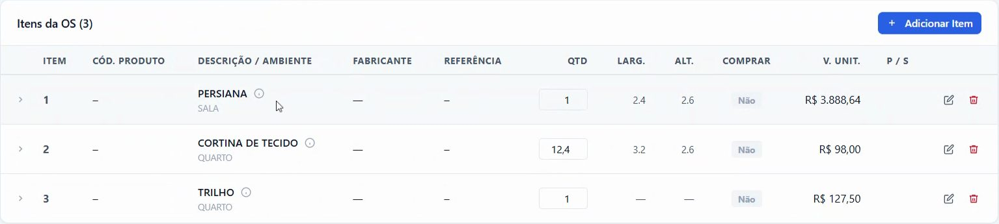
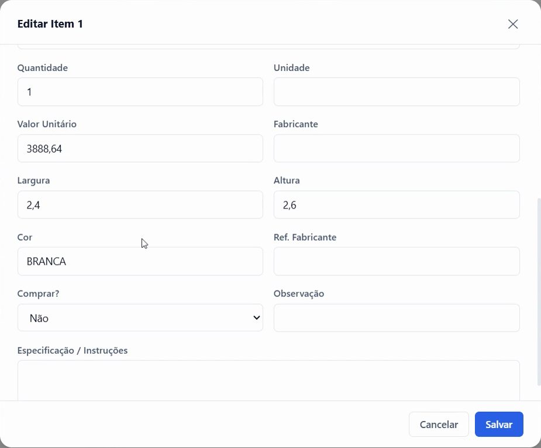
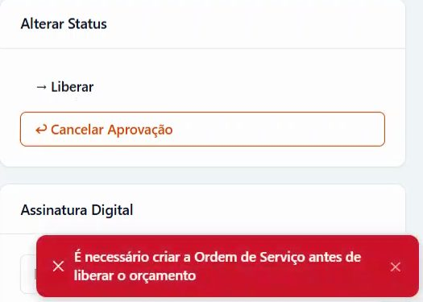
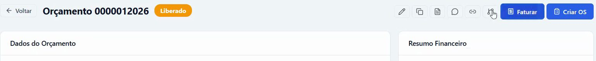

## Antes de começar

- O orçamento precisa estar **Aprovado**. Veja [Aprovar um orçamento](/decor/orcamentos/aprovar-orcamento/).
- Permissões:
  - **Ordens de Serviço › Criar**, para criar a O.S.;
  - **Orçamentos › Editar**, para liberar;
  - **Monitor Fiscal › Emitir**, para faturar.

## 1. Criar a ordem de serviço

1. Abra o orçamento aprovado e clique em **Criar OS**, no topo da tela.

   

2. A O.S. é criada com os itens do orçamento e abre em **Comercial › Ordens de Serviço**, com o status **Aberta**.

   

3. Em cada item, clique no ícone de editar e revise quantidade, fabricante, medidas e cor. Quando o item estiver pronto para a compra, coloque **Comprar?** em **Sim** e clique em **Salvar**. Veja [Liberar os itens da OS para compra](/decor/ordens-servico/liberar-compras/).

   

Depois disso, o botão no orçamento passa a mostrar **OS #…** e leva direto à O.S. Cada orçamento tem uma O.S. só.

Se você clicar em **→ Liberar** antes de criar a O.S., o sistema avisa que ela está faltando.

## 2. Liberar o orçamento

1. Volte ao orçamento e confira o quadro **Parcelas**: a soma tem de bater com o **TOTAL FINAL** (líquido + frete). Se aparecer o aviso em laranja, ajuste as parcelas antes.
2. Em **Alterar Status**, clique em **→ Liberar**.

O status passa para **Liberado**. Pedido, parcelas e O.S. não mudam. No quadro **Alterar Status** passa a aparecer **↩ Cancelar Liberação**, e no topo da tela, o botão **Faturar**.

A liberação confere só a O.S. e as parcelas. Ela não confere os fluxos de pós-venda nem o campo **Comprar?** dos itens: marque para compra apenas os itens já revisados.

## 3. Faturar

1. No orçamento **Liberado**, clique em **Faturar**, no topo da tela.
2. Em **Documento fiscal**, escolha:
   - **NF-e · modelo 55**, para pessoa jurídica ou física;
   - **NFC-e · modelo 65**, somente para pessoa física (consumidor).
3. Em **Tipo de faturamento**, escolha **Venda normal**, quando a mercadoria sai junto com a nota, ou **Entrega futura**, quando a nota sai agora e a entrega depois. Essa escolha define o CFOP e a natureza de operação. Ela vem preenchida com o **Tipo de venda (fiscal)** do orçamento.
4. Em **Transporte**, ajuste a **Quantidade de volumes**.
5. Confira o **Resumo financeiro**. A etiqueta precisa mostrar **Parcelas conferem**.
6. Clique em **Faturar R$ …**. Aguarde **Gerando nota fiscal…** sem fechar a janela.
7. Em **Orçamento faturado**, clique em **Abrir Monitor Fiscal**, confira a nota e transmita ao SEFAZ.

## Resultado esperado

O orçamento passa para **Faturado**, mesmo que a entrega ainda não tenha acontecido. A nota fica como **rascunho** em **Fiscal › Monitor Fiscal** e **não** é transmitida ao SEFAZ automaticamente. Volumes e outros dados podem ser ajustados no rascunho antes da transmissão.

## Acompanhar compra e entrega dos itens

No orçamento, abra o quadro **Rastreamento de Itens** para ver, item a item, a O.S., o pedido de compra, a chegada e a entrega. Clique em **Atualizar** para buscar a posição mais recente. O ícone 🔍 da linha do item diagnostica por que ele aparece ou não no painel de compras.

## Se algo der errado

| Mensagem ou sintoma | O que fazer |
|---|---|
| "É necessário criar a Ordem de Serviço antes de liberar o orçamento" | Clique em **Criar OS** e libere de novo. |
| "A soma das parcelas (…) não bate com o total do orçamento + frete (…). Diferença: …" | Ajuste as parcelas no quadro **Parcelas** até a diferença zerar. |
| "Já existe uma OS vinculada a este orçamento" | A O.S. já foi criada. Use o botão **OS #…** para abri-la. |
| O botão **Faturar R$ …** fica cinza, com **Parcelas divergentes** | A soma das parcelas difere do total da nota. Feche a janela, ajuste as parcelas e fature de novo. |
| O botão **Faturar** não aparece | O orçamento não está **Liberado**. |

Para as demais mensagens, veja [Não consigo aprovar ou liberar o orçamento](/decor/orcamentos/erro-nao-consigo-aprovar-ou-liberar/).
