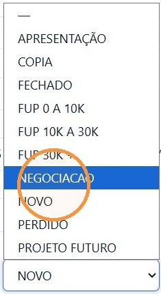
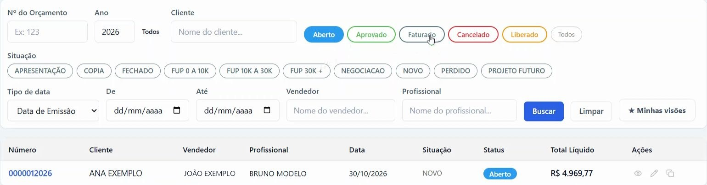
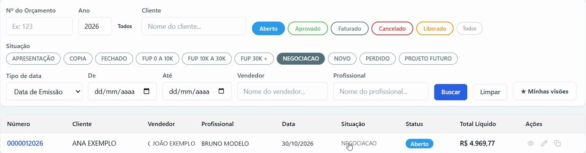

## Antes de começar

- Permissão necessária: **Orçamentos › Editar**.
- As situações são cadastradas pela loja em **Comercial › Cadastro › Situações**. Os nomes deste artigo são exemplos.

## Passo a passo

1. Acesse **Comercial › Orçamentos**, clique no número do orçamento e depois em **Editar**.
2. No campo **Situação**, escolha a nova situação, por exemplo **NEGOCIACAO**.

   

3. Clique em **Salvar Alterações**.

## Encontrar os orçamentos de uma situação

1. Em **Comercial › Orçamentos**, escolha o status: **Aberto**, **Aprovado**, **Faturado**, **Cancelado**, **Liberado** ou **Todos**.
2. Em **Situação**, clique na situação e depois em **Buscar**.

   

Depois da troca, o orçamento sai da lista da situação antiga e aparece na da nova.

## Status e situação não são a mesma coisa

- O **status** mostra a etapa do orçamento (**Aberto**, **Aprovado**, **Liberado**, **Faturado**, **Cancelado**) e muda pelos botões do quadro **Alterar Status**.
- A **situação** mostra o ponto da negociação e é trocada à mão, no campo **Situação**.
- Duas situações mudam sozinhas: ao aprovar, o orçamento passa para **FECHADO**; ao cancelar a aprovação, volta para **NEGOCIACAO**.
- Para aprovar, o orçamento precisa estar em **NEGOCIACAO**.

Veja mais em [Como funciona o orçamento](/decor/orcamentos/como-funciona-o-orcamento/).

## Exemplos de situação

| Situação | Quando usar |
|---|---|
| **NOVO** | O orçamento acabou de ser criado. |
| **NEGOCIACAO** | O cliente está negociando. É a situação exigida para aprovar. |
| **FUP 0 A 10K**, **FUP 10K A 30K**, **FUP 30K +** | Follow-up, separado por faixa de valor do orçamento. |
| **PROJETO FUTURO** | Não é o momento de fechar, mas o cliente pode voltar. |
| **PERDIDO** | O cliente não vai fazer o pedido. |
| **COPIA** | O orçamento é mais uma versão de outro. |

Se a situação tiver uma ocorrência e um prazo configurados no cadastro, cada mudança para ela cria uma tarefa de follow-up na **Carteira**.
