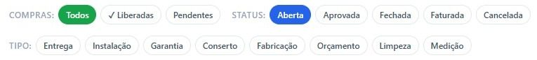
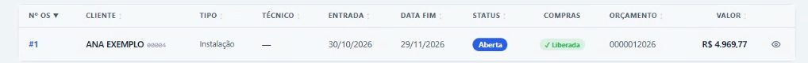

## Antes de começar

- Permissão necessária: **Ordens de Serviço › Listar**.

## Passo a passo

1. No menu, em **Comercial**, clique em **Ordens de Serviço**.
2. A lista abre com o filtro **Aberta** marcado em **Status**. Para ver outras OS, use os filtros:
   - **Compras:** **Todos**, **✓ Liberadas** ou **Pendentes**;
   - **Status:** **Aberta**, **Aprovada**, **Fechada**, **Faturada** ou **Cancelada**, um ou mais;
   - **Tipo:** **Entrega**, **Instalação**, **Garantia**, **Conserto**, **Fabricação**, **Orçamento**, **Limpeza** ou **Medição**.

   

3. Para buscar uma OS específica, digite o número, o orçamento, o cliente ou o técnico na busca.
4. Clique no número da OS para abri-la.

## O que cada coluna mostra

| Coluna | O que é |
|---|---|
| **Nº OS**, **Cliente** e **Tipo** | Qual é a OS, de quem e para quê. |
| **Técnico** | O técnico responsável, quando houver. |
| **Entrada** | Quando o orçamento foi feito. |
| **Data Fim** | O prazo limite de entrega. |
| **Status** | Em que ponto a OS está (veja abaixo). |
| **Compras** | **✓ Liberada** quando os itens foram liberados para compra. |
| **Orçamento** e **Valor** | O orçamento que gerou a OS e o valor. |

## Os status da OS

| Status | Quer dizer |
|---|---|
| **Aberta** | A OS foi criada e os itens ainda estão sendo revisados e liberados. |
| **Aprovada** | A OS foi aprovada e ainda pode ser editada. |
| **Fechada** | Todos os itens foram liberados para compra. A OS fecha sozinha e não pode mais ser editada. Veja [Liberar os itens da OS para compra](/decor/ordens-servico/liberar-compras/). |
| **Faturada** | A OS foi faturada. |
| **Cancelada** | A OS foi cancelada. |

A tela também filtra por **Origem**, **Condição da OS**, **Tipo de Atendimento**, **Garantia** e **Motivo do Retorno**.
