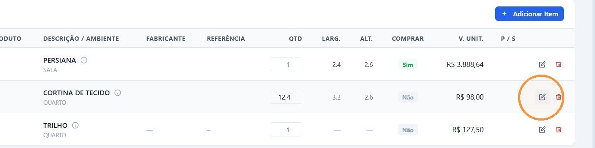
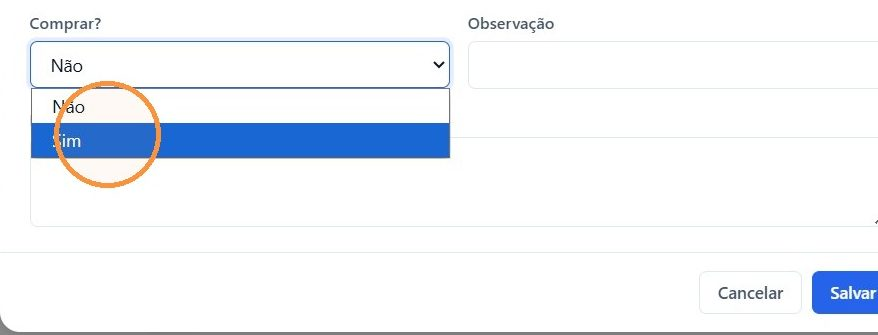
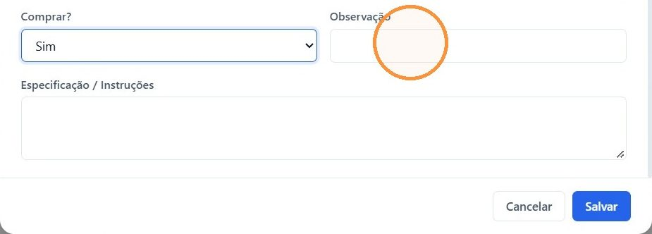
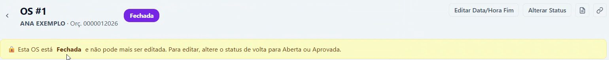

## Antes de começar

- Permissão necessária: **Ordens de Serviço › Editar**.
- A OS precisa estar **Aberta**. Ela é criada pelo botão **Criar OS** do orçamento aprovado. Veja [Criar a O.S., liberar e faturar o orçamento](/decor/orcamentos/liberar-e-faturar/).
- Confira a medição antes de liberar. A compra sai com as medidas do item.

## Passo a passo

1. No orçamento, clique no botão da OS, no topo da tela (por exemplo, **OS #1**).

   

2. Em **Itens da OS**, clique no ícone de editar do item.

   

3. Na janela **Editar Item**, revise quantidade, fabricante, medidas e cor. Em **Comprar?**, escolha **Sim**.

   

4. Se houver, anote em **Observação** e em **Especificação / Instruções** o que a compra ou a instalação precisa saber.
5. Clique em **Salvar**.

   

6. Repita nos outros itens.

## Resultado esperado

Cada item com **Sim** na coluna **Comprar** fica liberado para compra. Quando o último item recebe **Sim**, a OS passa sozinha para **Fechada**, e aparece o aviso de que ela não pode mais ser editada.

## Editar uma OS fechada

Para corrigir um item depois que a OS fechou, clique em **Alterar Status** e volte a OS para **Aberta** ou **Aprovada**. Faça a correção e libere de novo.
