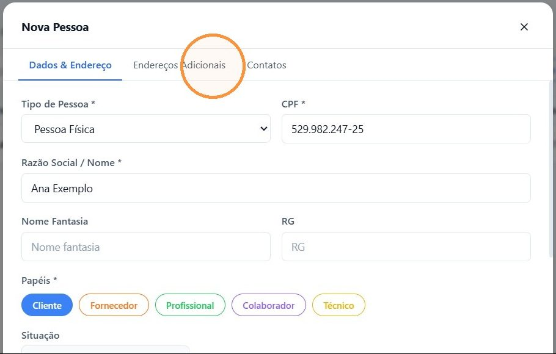
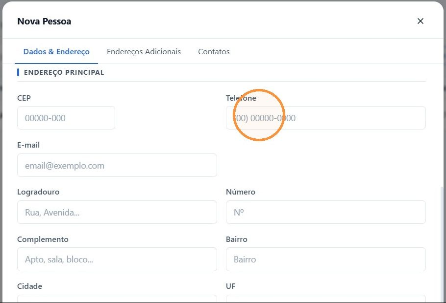
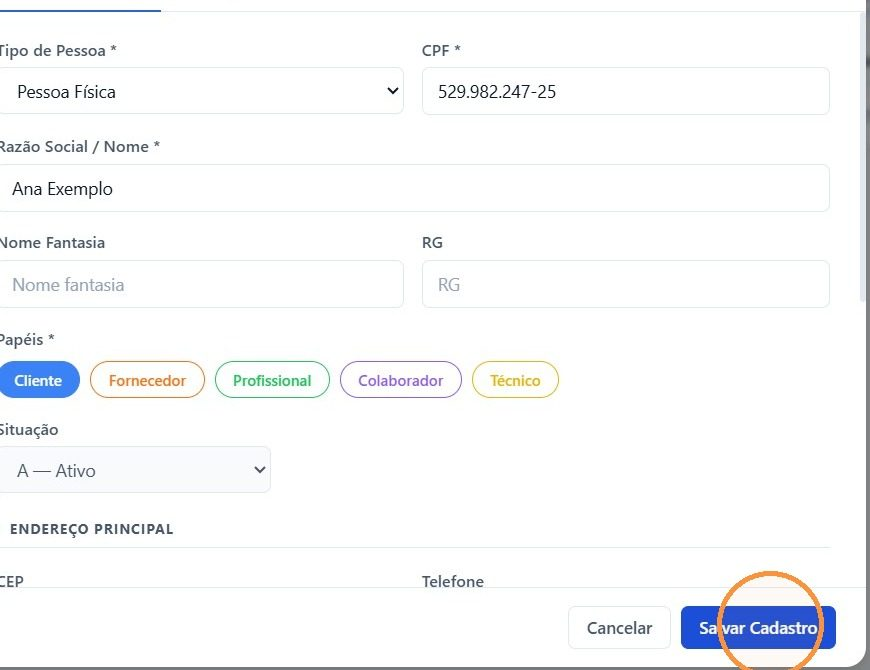

## Antes de começar

- Permissão necessária: **Pessoas › Criar**. Para corrigir um cadastro, **Pessoas › Editar**.
- **Busque antes de cadastrar.** Em **Comercial › Pessoas**, procure pelo nome, CPF ou CNPJ. Assim você evita cadastro repetido.

## Passo a passo

1. Acesse **Comercial › Pessoas** e clique em **+ Nova Pessoa**.

   

2. Em **Tipo de Pessoa**, escolha **Pessoa Física** ou **Pessoa Jurídica** e preencha o **CPF** ou o **CNPJ**.
3. Preencha **Razão Social / Nome** e, em **Papéis**, marque **Cliente**.

   

4. Em **Endereço Principal**, preencha o telefone e o endereço: logradouro, número, complemento, bairro, cidade e UF.

   

5. Se precisar, use as outras abas:
   - **Endereços Adicionais:** outros endereços do cliente, como o de entrega ou o de cobrança;
   - **Contatos:** outros telefones e meios de contato.
6. Clique em **Salvar Cadastro**.

   

## Resultado esperado

O cliente aparece na busca de **Comercial › Pessoas** e já pode ser escolhido em **Código / Nome do Cliente** ao [criar um orçamento](/decor/orcamentos/criar-orcamento/).

## Encontrar e corrigir um cadastro

1. Em **Comercial › Pessoas**, busque pelo código, nome, CPF ou CNPJ. Os botões ao lado da busca filtram por papel: **Cliente**, **Fornecedor**, **Profissional**, **Colaborador** e **Técnico**.
2. Clique no lápis da linha para abrir **Editar Pessoa**.
3. Corrija o dado e clique em **Salvar Cadastro**. O campo **Situação** também fica nessa tela.

## Dicas

- **Os campos com asterisco são obrigatórios:** **Tipo de Pessoa**, **CPF** ou **CNPJ**, **Razão Social / Nome** e **Papéis**.
- **Preencha o telefone com WhatsApp.** É o número usado para falar com o cliente no orçamento e no pós-venda.
- **Entrega em outro endereço?** Cadastre em **Endereços Adicionais**.
- **Uma pessoa pode ter mais de um papel.** Um arquiteto, por exemplo, pode ser também **Cliente** quando faz uma compra pessoal.
- **Para aprovar o orçamento, o cadastro precisa estar completo:** CPF ou CNPJ, endereço e ao menos um contato. Um cliente criado pelo atalho **+ Cadastrar cliente** do orçamento tem só o nome e precisa ser completado aqui.
