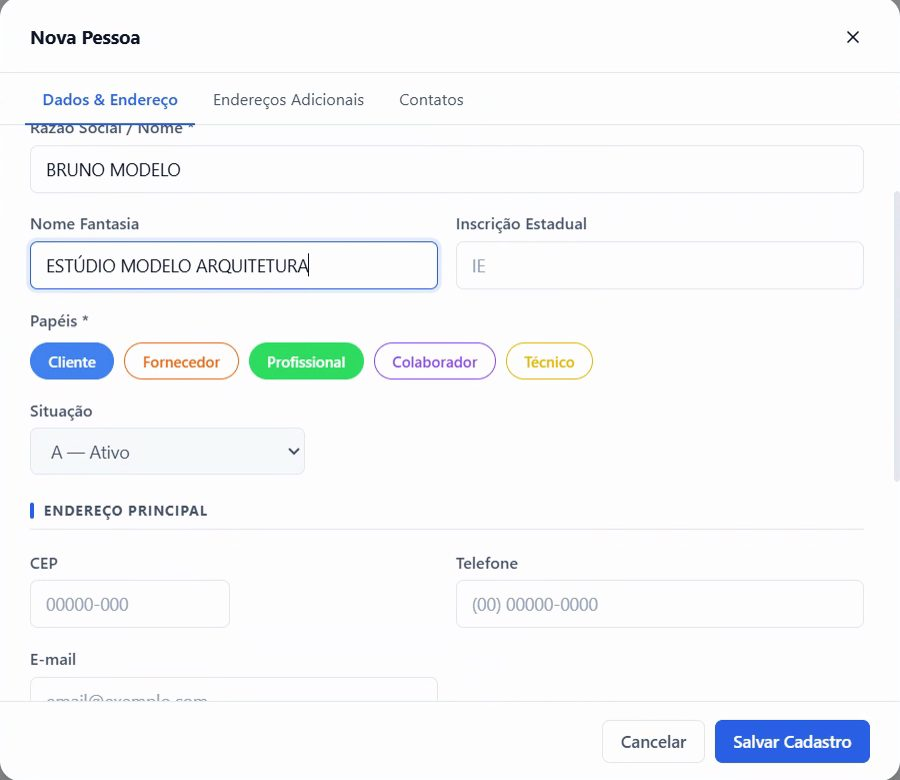
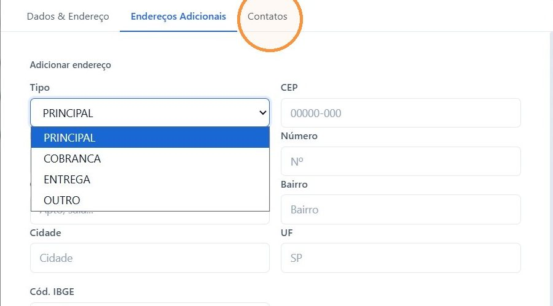

## Antes de começar

- Permissão necessária: **Pessoas › Criar**.
- Todo orçamento exige um **Profissional / Arquiteto**. Por isso, o profissional precisa estar cadastrado antes de criar o orçamento.

## Passo a passo

1. Acesse **Comercial › Pessoas** e clique em **+ Nova Pessoa**.
2. Em **Papéis**, marque **Profissional**. É isso que diferencia este cadastro do cadastro de um cliente.

   

3. Em **Tipo de Pessoa**, escolha **Pessoa Jurídica** e preencha o **CNPJ**. Se o profissional não tem CNPJ, escolha **Pessoa Física** e preencha o **CPF**.
4. Preencha o nome do profissional em **Razão Social / Nome**.
5. Em **Nome Fantasia**, coloque o nome do escritório.

   

6. Em **Endereço Principal**, preencha o endereço e o telefone.
7. Se precisar, use as outras abas:
   - **Endereços Adicionais:** o endereço do escritório ou outro endereço do profissional;
   - **Contatos:** outros contatos do profissional.

   

8. Clique em **Salvar Cadastro**.

## Resultado esperado

O profissional aparece em **Comercial › Pessoas** com o filtro **Profissional** e pode ser escolhido em **Profissional / Arquiteto** no orçamento.

## Venda sem arquiteto

Como o campo **Profissional / Arquiteto** é obrigatório, mantenha um cadastro de profissional para as vendas sem arquiteto, por exemplo **NÃO INFORMADO**, e escolha esse cadastro no orçamento.

## Dicas

- **O profissional pode ser cliente também.** Marque **Cliente** junto com **Profissional** se ele fizer uma compra pessoal.
- **Os campos com asterisco são obrigatórios:** **Tipo de Pessoa**, **CPF** ou **CNPJ**, **Razão Social / Nome** e **Papéis**.

## Se algo der errado

| Mensagem ou sintoma | O que fazer |
|---|---|
| **CNPJ inválido** | O número não confere com os dígitos verificadores. Confira o CNPJ e digite de novo. |
| O profissional não aparece no orçamento | Confira se o papel **Profissional** está marcado no cadastro. |
