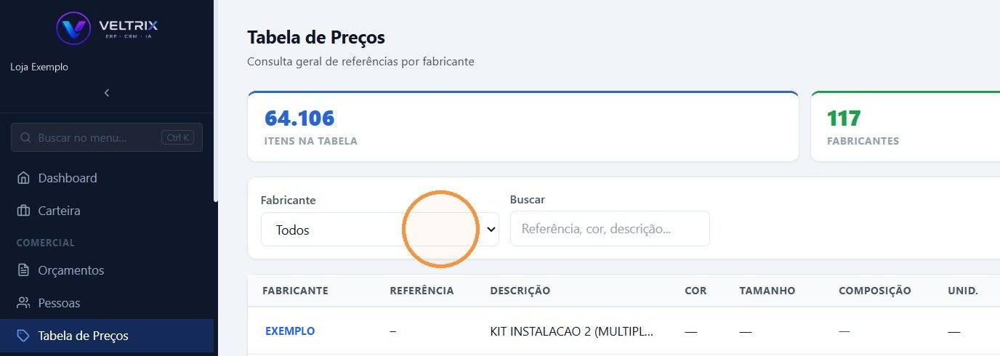
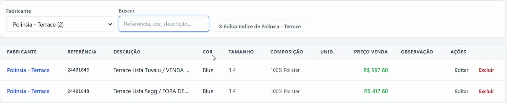

## Antes de começar

- Permissão necessária: **Tabela de Preços › Visualizar**.

## Passo a passo

1. Acesse **Comercial › Tabela de Preços**.

   

2. Em **Fabricante**, escolha o fabricante. Com **Todos**, aparece a tabela de todos os fabricantes.
3. Em **Buscar**, digite a referência, a cor ou parte da descrição.
4. Na lista, confira **Referência**, **Descrição**, **Cor**, **Tamanho**, **Composição** e **Preço Venda**.

   

## Resultado esperado

Você encontra o preço de venda do produto. No orçamento, o mesmo preço é preenchido sozinho quando você escolhe o fabricante e clica na linha da tabela. Veja [Criar um orçamento](/decor/orcamentos/criar-orcamento/).
